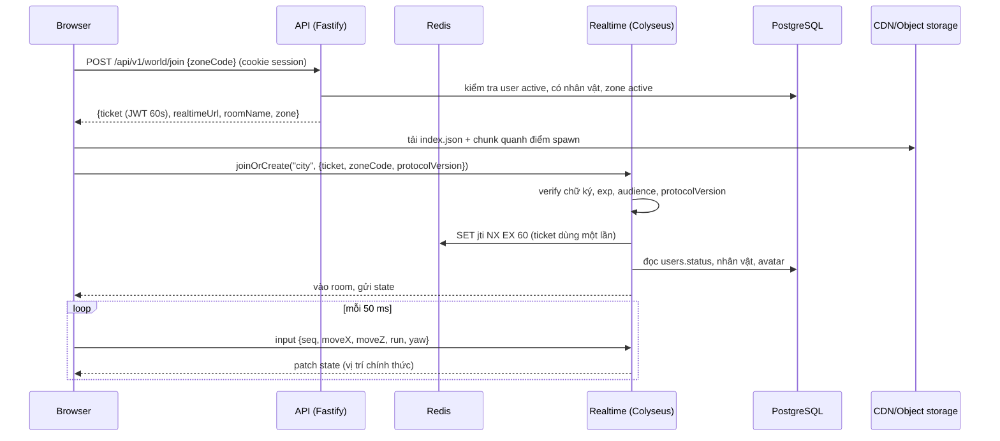
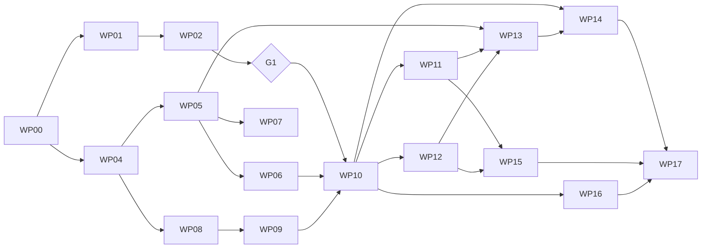

# DA NANG WORLD

## Tài liệu phân tích và thiết kế hệ thống -- Phiên bản 2.0

-   **Loại sản phẩm:** Game khám phá thành phố 3D trực tuyến nhiều người
    chơi
-   **Nền tảng:** Web desktop và web mobile (trình duyệt)
-   **Bối cảnh:** Thành phố Đà Nẵng, Việt Nam
-   **Ngôn ngữ giao diện:** Tiếng Việt (`vi`) và tiếng Anh (`en`)
-   **Phạm vi phát hành đầu tiên:** Tạo tài khoản, chọn nhân vật nam/nữ,
    vào thế giới, đi bộ/chạy, gặp người chơi khác và khám phá địa danh
-   **Tên dự án:** Da Nang World (tên tạm thời)
-   **Cơ sở dữ liệu:** PostgreSQL + PostGIS (đã chốt, không dùng MySQL)
-   **Đối tượng sử dụng tài liệu:** đội phát triển và AI coding agent.
    Các mục 5.5, 7.10--7.13, 8.5--8.13, 9.6--9.9, 14.6--14.10, 15 và
    16--19 là đặc tả triển khai. Khi có mâu thuẫn giữa các mục, mục 21
    (quyết định đã chốt) có ưu tiên cao nhất.

------------------------------------------------------------------------

# 1. Tóm tắt sản phẩm

Da Nang World là một game 3D trực tuyến mô phỏng một phần thành phố Đà
Nẵng. Người chơi truy cập bằng trình duyệt, tạo tài khoản, chọn nhân vật
nam hoặc nữ, sau đó đi dạo trong thành phố cùng những người chơi khác.

Trọng tâm của phiên bản đầu tiên không phải chiến đấu hay nhiệm vụ phức
tạp, mà là cảm giác được hiện diện trong một thành phố ảo có bố cục
đường phố và địa danh dựa trên Đà Nẵng thật.

## 1.1. Mục tiêu sản phẩm

1.  Tạo một thế giới 3D có thể chạy trên máy tính và điện thoại.
2.  Cho nhiều người chơi cùng xuất hiện trong một khu vực.
3.  Dùng dữ liệu địa lý thật làm nền tảng cho đường phố và vị trí địa
    danh.
4.  Tạo trải nghiệm khám phá dễ hiểu, không yêu cầu người chơi biết chơi
    game trước đó.
5.  Có hệ thống quản trị nội dung và tài khoản để vận hành sản phẩm.
6.  Thiết kế kiến trúc có thể mở rộng nhưng không xây dựng quá mức cần
    thiết ở MVP.
7.  Cho người chơi lấy và lái xe đạp, xe máy, ô tô dọc đường phố.
8.  Tổ chức nội dung đồ họa (nhân vật, phương tiện, địa danh, bản đồ, giao
    diện game) theo thư mục riêng, để bổ sung mục mới mà không phải sửa
    code (mục 16).

## 1.2. Định nghĩa thành công cho phiên bản đầu tiên

Phiên bản đầu tiên được xem là đạt yêu cầu khi:

-   Người dùng có thể đăng ký, đăng nhập và đăng xuất.
-   Người dùng có thể chọn nhân vật nam hoặc nữ.
-   Người dùng có thể vào bản đồ, di chuyển, xoay camera và nhìn thấy
    người chơi khác.
-   Vị trí nhân vật được đồng bộ đủ mượt giữa các máy.
-   Người chơi có thể đến gần một địa danh và mở bảng thông tin.
-   Nội dung địa danh hiển thị đúng ngôn ngữ đã chọn.
-   Quản trị viên có thể quản lý tài khoản và nội dung địa danh.
-   Game hoạt động trên các trình duyệt desktop và mobile được hỗ trợ.
-   Hệ thống không tải toàn bộ thành phố và toàn bộ tài nguyên cùng một
    lúc.
-   Người chơi có thể lên xe đạp, xe máy hoặc ô tô đậu dọc đường, lái, và
    xuống xe; người chơi khác nhìn thấy xe đang được lái mượt.
-   Thêm nhân vật, phương tiện, địa danh hoặc khu vực bản đồ mới bằng cách
    thêm thư mục nội dung theo mẫu (mục 16), không sửa code ứng dụng.

## 1.3. Không nằm trong phạm vi MVP

Các tính năng sau được để dành cho các phiên bản sau:

-   Thuyền, xe buýt/phương tiện công cộng, xe nhiều chỗ ngồi (hành
    khách), sở hữu hoặc tùy biến phương tiện, giao thông NPC tự chạy.
-   Va chạm gây sát thương, cướp xe, phạt giao thông.
-   Chiến đấu, vũ khí, cướp bóc hoặc cơ chế phạm pháp.
-   Hệ thống nhiệm vụ phức tạp, tiền tệ và cửa hàng.
-   Voice chat, livestream hoặc chat thế giới tự do.
-   Nhà riêng, căn hộ, nội thất có thể đi vào.
-   Hệ thống bang hội, bạn bè nâng cao.
-   Toàn bộ địa giới thành phố Đà Nẵng với mức chi tiết cao.
-   Ứng dụng native iOS/Android.

------------------------------------------------------------------------

# 2. Đối tượng người dùng và vai trò

## 2.1. Vai trò trong hệ thống

  Vai trò          Quyền chính
  ---------------- -------------------------------------------------------------
  Guest            Xem trang giới thiệu, chọn ngôn ngữ, đăng ký/đăng nhập
  Player           Chơi game, chọn nhân vật, xem địa danh, gặp người chơi khác
  Moderator        Xử lý báo cáo, mute/kick người chơi theo quyền được cấp
  Content Editor   Tạo/sửa địa danh, bản dịch, hình ảnh và nội dung
  Admin            Quản lý người dùng, nội dung, phòng chơi và cấu hình
  Super Admin      Toàn quyền, quản lý vai trò và cấu hình nhạy cảm

Không nên cấp quyền quản trị bằng cách chỉ dựa vào một trường `is_admin`
trên giao diện. Quyền phải được xác minh ở API/backend.

## 2.2. Luồng người chơi mới

1.  Mở website.
2.  Chọn tiếng Việt hoặc English.
3.  Đăng ký bằng email/mật khẩu hoặc phương thức đăng nhập được hỗ trợ.
4.  Xác minh email nếu chính sách sản phẩm yêu cầu.
5.  Chọn nhân vật nam hoặc nữ.
6.  Chọn một trong các kiểu ngoại hình mặc định.
7.  Xác nhận tên hiển thị.
8.  Chọn nút "Vào thành phố".
9.  Hệ thống tìm một phòng/khu vực phù hợp.
10. Tải tài nguyên khu vực cần thiết.
11. Nhân vật xuất hiện tại điểm spawn an toàn.
12. Người chơi bắt đầu đi dạo.

## 2.3. Luồng người chơi quay lại

1.  Đăng nhập.
2.  Backend lấy hồ sơ và nhân vật đã chọn.
3.  Người chơi vào thế giới.
4.  Máy chủ chọn spawn point hợp lệ gần vị trí lần trước hoặc điểm trung
    tâm.
5.  Client tải chunk bản đồ xung quanh.
6.  Kết nối realtime và nhận trạng thái người chơi trong cùng phòng.

Không nên tự động khôi phục tọa độ cũ nếu vị trí đó đã bị thay đổi, bị
khóa hoặc nằm ngoài vùng chơi hiện hành.

------------------------------------------------------------------------

# 3. Thiết kế trải nghiệm game

## 3.1. Góc nhìn và điều khiển

Đề xuất góc nhìn thứ ba (third-person), camera đặt phía sau và hơi cao
hơn nhân vật.

### Desktop

  Thao tác             Điều khiển
  -------------------- -----------------------------------
  Đi tới               W
  Đi lùi               S
  Sang trái            A
  Sang phải            D
  Chạy                 Shift
  Xoay camera          Giữ chuột phải và di chuyển chuột
  Tương tác địa danh   E hoặc click nút tương tác
  Thoát menu           Escape

### Mobile

-   Joystick ảo bên trái để di chuyển.
-   Kéo vùng bên phải màn hình để xoay camera.
-   Nút chạy đặt gần joystick hoặc bên phải.
-   Nút tương tác xuất hiện theo ngữ cảnh.
-   Nút menu, bản đồ và cài đặt đặt ở vùng dễ chạm.
-   Hỗ trợ màn hình dọc/ngang, nhưng ưu tiên ngang khi chơi.

### Điều khiển khi lái xe

| Thao tác | Desktop | Mobile |
|---|---|---|
| Lên/xuống xe | F hoặc nút "Lên xe"/"Xuống xe" | Nút ngữ cảnh gần xe |
| Ga / lùi | W / S | Joystick dọc (lên/xuống) hoặc nút Ga/Phanh |
| Lái trái/phải | A / D | Joystick ngang hoặc nghiêng màn hình (tùy chọn) |
| Phanh tay | Space | Nút phanh tay |
| Xoay camera | Chuột phải (camera quay về sau xe khi thả) | Kéo vùng phải màn hình |

Khi đang lái, phím E (tương tác địa danh) vẫn hoạt động nếu xe đang chậm.

### Yêu cầu UX

-   Có màn hình hướng dẫn điều khiển lần đầu.
-   Có thể ẩn/hiện hướng dẫn.
-   Không đặt nút sát mép tai thỏ hoặc vùng gesture của điện thoại.
-   Có tùy chọn độ nhạy camera.
-   Có tùy chọn đảo trục camera nếu cần.
-   Không khóa con trỏ chuột trên mobile.
-   Khi tab trình duyệt mất focus, client phải giảm hoặc tạm dừng cập
    nhật hình ảnh.

## 3.2. Trạng thái nhân vật

MVP chỉ cần các trạng thái:

-   `idle`: đứng yên.
-   `walk`: đi bộ.
-   `run`: chạy.
-   `turn`: đổi hướng nếu bộ animation hỗ trợ.
-   `emote`: có thể bổ sung sau, không bắt buộc MVP.
-   `ride`: đang ngồi trên xe (xe đạp, xe máy, ô tô); tư thế theo loại
    xe (mục 3.6).

Nhân vật nam/nữ là lựa chọn avatar. Không nên tạo hai hệ thống gameplay
khác nhau. Cả hai dùng chung bộ điều khiển, hitbox và quy tắc di chuyển.

## 3.3. Tùy chỉnh nhân vật

MVP nên giới hạn tùy chỉnh để kiểm soát dung lượng:

-   Giới tính hiển thị: nam/nữ.
-   Một số mẫu tóc.
-   Một số bộ trang phục mặc định.
-   Màu sắc trang phục nếu có thể triển khai đơn giản.
-   Tên hiển thị.

Mỗi avatar cần có: - Mã avatar ổn định. - Loại hình thể hoặc rig tương
thích. - Model GLB/GLTF. - Bộ animation tương thích. - Thumbnail. -
Trạng thái có thể chọn/đang ẩn.

Không cho người chơi tải model tùy ý lên trong MVP vì rủi ro bảo mật,
kiểm duyệt và hiệu năng.

## 3.4. Hiển thị người chơi khác

Thông tin trên đầu nhân vật:

-   Tên hiển thị.
-   Có thể thêm biểu tượng trạng thái sau này.
-   Không hiển thị email hoặc dữ liệu cá nhân.

Quy tắc: - Chỉ đồng bộ người chơi trong cùng room/instance. - Giới hạn
số nhân vật hiển thị gần người chơi. - Ưu tiên người chơi ở gần. - Người
chơi đi xa hoặc mất kết nối sẽ bị loại khỏi danh sách hiển thị sau
timeout. - Có thể dùng avatar chất lượng thấp hơn ở khoảng cách xa.

## 3.5. Khám phá địa danh

Khi đến gần một địa danh:

1.  Client nhận danh sách địa danh gần vị trí hiện tại.
2.  Nếu khoảng cách nằm trong bán kính tương tác, hiện nút "Khám phá".
3.  Người chơi bấm nút hoặc phím E.
4.  Mở bảng thông tin.
5.  Hiển thị tên, ảnh, mô tả, địa chỉ/khu vực và thông tin bổ sung.
6.  Nội dung lấy theo ngôn ngữ hiện tại.
7.  Nếu thiếu bản dịch, fallback về tiếng Việt hoặc ngôn ngữ mặc định đã
    cấu hình.

MVP không bắt buộc lưu thành tích đã khám phá. Tuy nhiên, database nên
có bảng `player_discoveries` để bật tính năng này mà không phải thiết kế
lại từ đầu.

## 3.6. Phương tiện

Phương tiện cá nhân đậu dọc đường để người chơi lấy và lái. Một chỗ
ngồi (chỉ người lái) ở MVP; dữ liệu thiết kế sẵn dạng danh sách ghế để
thêm hành khách sau.

| Loại | Đặc điểm | Tốc độ khởi điểm (cấu hình, chỉnh sau khi thử) |
|---|---|---|
| Xe đạp (`bicycle`) | Chậm, đi được cả vỉa hè/khu đi bộ | tối đa khoảng 5.5 m/s |
| Xe máy (`motorbike`) | Phổ biến nhất, linh hoạt | tối đa khoảng 14 m/s |
| Ô tô (`car`) | Nhanh, rộng, chỉ chạy tốt trên đường | tối đa khoảng 18 m/s |

Quy tắc:

-   Xe đậu dọc đường tại các điểm spawn phương tiện; mỗi room có số xe tối
    đa cấu hình được. Xe không thuộc sở hữu của ai, ai đến trước thì lái.
-   Lên xe: đứng cách xe không quá 3 m, xe chưa có người lái, nhấn F hoặc
    nút "Lên xe".
-   Xuống xe: nhấn F hoặc nút "Xuống xe" khi tốc độ không quá 3 m/s;
    nhân vật xuất hiện cạnh xe tại vị trí hợp lệ (không nằm trong vật cản).
-   Xe va chạm với công trình và mặt nước (trượt dọc vật cản, mất tốc độ);
    **không** va chạm với người chơi và xe khác (đi xuyên qua nhau) để tránh
    phá game, chặn đường và đồng bộ phức tạp. Không có sát thương.
-   Bề mặt ảnh hưởng tốc độ tối đa: đường, khu đi bộ/vỉa hè, đất trống. Ô tô
    bị chậm rõ khi rời đường; xe đạp gần như không bị ảnh hưởng trên vỉa hè.
-   Xe bị bỏ lại (không người lái ít nhất 120 giây và không có người chơi trong
    20 m) tự quay về điểm spawn gốc, tránh xe chặn đường lâu dài.
-   Người lái hiển thị trên xe với tư thế phù hợp (xe đạp, xe máy). Ô tô: ẩn
    người lái hoặc hiển thị tư thế ngồi, tuỳ cấu hình trong manifest xe.
-   Không lưu sở hữu/trạng thái xe vào tài khoản người chơi.
-   Mọi loại xe và thông số lái khai báo trong `content/vehicles` (mục 16), không
    hard-code trong client hay server.

------------------------------------------------------------------------

# 4. Thiết kế thế giới và bản đồ Đà Nẵng

## 4.1. Chiến lược bản đồ

Không nên dựng thủ công toàn bộ thành phố ngay từ đầu. Nên kết hợp:

1.  Dữ liệu đường phố và footprint công trình từ OpenStreetMap.
2.  Dữ liệu địa hình/độ cao từ nguồn có giấy phép phù hợp.
3.  Mô hình 3D tự dựng cho địa danh nổi bật.
4.  Mô hình nhà cửa tự động từ footprint và chiều cao có sẵn.
5.  Asset môi trường như cây, đèn đường, vỉa hè, biển báo được bổ sung
    có chọn lọc.

Bản đồ game là bản tái dựng phục vụ gameplay, không phải bản sao đo đạc
chính xác tuyệt đối. Cần kiểm tra quyền sử dụng dữ liệu, attribution và
điều kiện phân phối dữ liệu phái sinh.

## 4.2. Khu vực thử nghiệm

Đề xuất MVP bắt đầu với một vùng nhỏ quanh:

-   Cầu Rồng.
-   Bờ đông và bờ tây sông Hàn.
-   Một phần đường Bạch Đằng.
-   Một phần đường Trần Hưng Đạo.
-   Khu vực gần chợ Hàn nếu phạm vi dữ liệu và tiến độ cho phép.

Lý do: - Có sông, cầu, đường lớn và công trình nổi bật. - Dễ tạo cảm
giác nhận diện Đà Nẵng. - Kích thước đủ nhỏ để tối ưu tải dữ liệu. - Có
thể mở rộng sang Sơn Trà và các quận khác sau khi kiểm chứng.

Phạm vi địa lý chính xác phải được chốt bằng polygon trong database/GIS,
không dùng mô tả tên quận làm giới hạn kỹ thuật.

## 4.3. Các lớp dữ liệu bản đồ

  Lớp                  Dữ liệu               Cách sử dụng
  -------------------- --------------------- --------------------------------
  Terrain              Địa hình, cao độ      Tạo mặt đất
  Water                Sông, hồ, biển        Mặt nước và ranh giới
  Road                 Đường, làn, giao lộ   Mặt đường và điều hướng
  Building footprint   Polygon tòa nhà       Tạo khối nhà
  Building height      Chiều cao             Extrusion hoặc model
  Landmark             Địa danh              Điểm tương tác
  Vegetation           Cây xanh              Asset trang trí
  Street furniture     Đèn, ghế, biển        Trang trí chọn lọc
  Spawn points         Điểm xuất hiện        Đặt nhân vật
  Collision            Vật cản               Ngăn nhân vật đi xuyên vật thể

## 4.4. Chia bản đồ thành chunk

Chia thế giới thành các ô/chunk theo lưới hoặc hệ tọa độ tile.

Mỗi chunk có: - ID. - Phạm vi địa lý. - Danh sách asset. - Đường và công
trình. - Collision data. - Điểm spawn. - Phiên bản dữ liệu. - Trạng thái
publish.

Quy tắc tải: - Tải chunk hiện tại và các chunk lân cận. - Tải trước
chunk theo hướng di chuyển. - Giải phóng asset xa. - Không gửi toàn bộ
hình học bản đồ qua WebSocket. - Dữ liệu bản đồ tĩnh nên được phân phối
qua CDN/object storage.

## 4.5. Hệ tọa độ

Dữ liệu địa lý dùng WGS84 (longitude/latitude, SRID 4326). Game engine
không nên dùng trực tiếp kinh độ/vĩ độ làm tọa độ thế giới.

Quy trình: 1. Lưu tọa độ địa lý trong PostGIS (SRID 4326, thứ tự
longitude, latitude). 2. Chuyển sang hệ tọa độ chiếu mét phù hợp cho khu
vực (UTM 49N, EPSG:32649). 3. Chọn một origin cố định cho mỗi zone. 4.
Chuyển thành tọa độ local X/Y/Z. 5. Dùng local coordinate trong Three.js
và trong `game-core`. Quy ước chi tiết ở mục 16.7.

Cần thống nhất trục: X là Đông (+X), Z là Nam (Bắc là -Z), Y là độ cao.

Phải kiểm tra hướng trục và đơn vị giữa dữ liệu GIS, Blender và
Three.js.

## 4.6. Địa danh

Mỗi địa danh là một thực thể dữ liệu độc lập, không hard-code trong
frontend.

Ví dụ nội dung: - Cầu Rồng. - Cầu Sông Hàn. - Chợ Hàn. - Bảo tàng Điêu
khắc Chăm. - Biển Mỹ Khê. - Ngũ Hành Sơn.

Mỗi địa danh có: - Tên tiếng Việt. - Tên tiếng Anh. - Mô tả ngắn và dài
theo ngôn ngữ. - Ảnh đại diện. - Tọa độ. - Bán kính tương tác. - Loại
địa danh. - Thứ tự hiển thị. - Trạng thái xuất bản. - Nguồn và thông tin
bản quyền nội dung/hình ảnh.

------------------------------------------------------------------------

# 5. Công nghệ đề xuất

## 5.1. Stack tổng thể

  -----------------------------------------------------------------------
  Thành phần              Công nghệ đề xuất       Vai trò
  ----------------------- ----------------------- -----------------------
  Web app                 Next.js + React +       Trang chủ, đăng nhập,
                          TypeScript              hồ sơ, admin

  3D renderer             Three.js                Render thế giới và nhân
                                                  vật

  3D framework            React Three Fiber (tùy  Tích hợp Three.js với
                          chọn)                   React

  Map data                OpenStreetMap + dữ liệu Đường, footprint, địa
                          GIS phù hợp             điểm

  GIS database            PostgreSQL + PostGIS    Lưu tọa độ và truy vấn
                                                  không gian

  Realtime multiplayer    Colyseus hoặc Node.js   Room, trạng thái người
                          WebSocket               chơi

  Cache / presence        Redis                   Session realtime, room
                                                  registry, rate limit

  API                     Node.js + TypeScript    API nghiệp vụ
                          (Fastify/NestJS)        

  ORM                     Prisma hoặc Drizzle     Truy cập database

  Asset storage           S3-compatible object    GLB, texture, ảnh
                          storage                 

  CDN                     CDN tương thích object  Phân phối asset
                          storage                 

  Authentication          Session/JWT an toàn     Xác thực người dùng

  Monitoring              Sentry +                Theo dõi lỗi và hiệu
                          metrics/logging         năng

  Deployment              Docker                  Đóng gói dịch vụ
  -----------------------------------------------------------------------

### Khuyến nghị lựa chọn

Đối với nhóm nhỏ, có thể bắt đầu bằng: - Next.js cho web và admin. - Một
Node.js API service. - Một Colyseus realtime service. -
PostgreSQL/PostGIS. - Redis. - Object storage/CDN.

Không nên tách thành quá nhiều microservice ngay từ đầu. Có thể triển
khai dạng modular monolith cho API và tách realtime server thành tiến
trình riêng.

## 5.2. Vì sao dùng Three.js?

-   Chạy trực tiếp trên trình duyệt.
-   Hỗ trợ WebGL và có hướng phát triển WebGPU.
-   Có hệ sinh thái model GLTF/GLB.
-   Có thể tích hợp với React/Next.js.
-   Kiểm soát được renderer và chiến lược tối ưu.

Lưu ý: không render game 3D trong server-side rendering. Phần game phải
được tải ở client bằng dynamic import hoặc client-only component.

## 5.3. Vì sao cần realtime server?

Không nên để trình duyệt của mỗi người tự quyết định vị trí người chơi
khác. Client có thể bị sửa dữ liệu.

Realtime server nên là authoritative server: - Client gửi input/ý định
di chuyển. - Server kiểm tra tốc độ và giới hạn. - Server cập nhật trạng
thái chính thức. - Server phát trạng thái cho các client trong room. -
Client nội suy chuyển động để hình ảnh mượt.

## 5.4. Mô hình room/instance

Không nên để toàn bộ người chơi trong một room duy nhất.

Đề xuất: - Mỗi khu vực có một hoặc nhiều instance. - Người chơi vào
instance có số người phù hợp. - Mỗi instance có giới hạn người chơi cấu
hình được. - Khi room gần đầy, hệ thống tạo room mới. - Khi room trống,
room được đóng sau thời gian chờ. - Chuyển khu vực bằng cơ chế
portal/zone transition trong các phiên bản sau.

MVP có thể bắt đầu với một khu vực và nhiều room cùng bản đồ.

------------------------------------------------------------------------

## 5.5. Đặc tả công nghệ chi tiết (đã chốt)

Mục này chốt các lựa chọn "hoặc" ở mục 5.1. Phiên bản: dùng bản stable
mới nhất tại thời điểm khởi tạo dự án và ghim bằng lockfile. Agent phải
đọc tài liệu chính thức của đúng phiên bản đã cài trước khi dùng API
(đặc biệt Next.js, Colyseus, Drizzle, React Three Fiber), không dựa vào
trí nhớ.

#### Nền tảng và công cụ

  Hạng mục          Lựa chọn                              Ghi chú
  ----------------- ------------------------------------- ----------------------------------------------
  Runtime           Node.js LTS (từ 22 trở lên)           Ghi `engines` trong `package.json`
  Package manager   pnpm workspaces                       Một lockfile duy nhất
  Build orchestration Turborepo                           Cache build/test/lint theo package
  Ngôn ngữ          TypeScript, ESM                       `strict: true`, `noUncheckedIndexedAccess`
  Lint/format       ESLint (flat config) + Prettier       Chạy trong CI
  Unit/integration  Vitest                                Dùng cho game-core, api, realtime
  E2E               Playwright                            Có kịch bản hai trình duyệt cùng vào room
  CI                GitHub Actions                        lint, typecheck, test, build, migrate thử

#### Web và game client

  Hạng mục         Lựa chọn                                  Vai trò
  ---------------- ----------------------------------------- ------------------------------------------
  Web framework    Next.js (App Router) + React              Trang chủ, auth, hồ sơ, admin, game shell
  Styling/UI       Tailwind CSS + shadcn/ui (Radix)          Component giao diện và admin
  i18n             next-intl                                 Giao diện tĩnh `vi`/`en`
  Data fetching    TanStack Query                            Gọi REST API, cache phía client
  Form             react-hook-form + zod                     Dùng chung schema với backend
  UI state         Zustand                                   Trạng thái menu, cài đặt, panel địa danh
  3D               three + @react-three/fiber + drei         Render thế giới, nhân vật
  Texture/model    KTX2Loader, MeshoptDecoder, GLTFLoader    Nạp GLB nén
  Realtime client  colyseus.js                               Kết nối room
  Joystick mobile  Tự viết bằng Pointer Events               Tránh phụ thuộc thư viện không cần thiết
  Profiling dev    r3f-perf hoặc stats-gl                    Overlay FPS/draw call khi dev

Quy tắc game client:

-   Component game chỉ được tải ở client (`dynamic(..., { ssr: false })`).
-   Vị trí người chơi và dữ liệu cập nhật mỗi frame lưu trong `ref`/đối
    tượng mutable, không đưa vào React state, để không re-render mỗi
    frame.
-   Mọi hàm di chuyển/va chạm dùng chung với server qua package
    `game-core`.

#### Realtime server

  Hạng mục          Lựa chọn                                Ghi chú
  ----------------- --------------------------------------- ----------------------------------
  Framework         Colyseus (0.16 trở lên)                 Room, matchmaking, state sync
  State sync        @colyseus/schema                        Delta patch, khai báo bằng decorator
  Transport         WebSocket (ws transport)                Qua reverse proxy có hỗ trợ upgrade
  Test              @colyseus/testing, @colyseus/loadtest   Test room và tải bot
  Redis client      ioredis                                 Pub/sub, ticket một lần, presence
  Ticket verify     jose                                    Xác minh JWT ngắn hạn

#### API

  Hạng mục          Lựa chọn                                   Ghi chú
  ----------------- ------------------------------------------ ---------------------------------
  Framework         Fastify 5                                  Ít boilerplate, hợp agent sinh code
  Validation        zod + fastify-type-provider-zod            Schema dùng chung `packages/schemas`
  Bảo mật HTTP      @fastify/helmet, @fastify/cookie           Header an toàn, cookie session
  Rate limit        @fastify/rate-limit (store Redis)          Theo IP, user, endpoint
  Upload            @fastify/multipart + sharp                 Kiểm tra magic bytes, đổi sang WebP
  Password          argon2 (Argon2id)                          Tham số theo khuyến nghị OWASP
  Email             nodemailer (SMTP)                          Mailpit khi dev
  ID                uuidv7                                     UUID sắp xếp theo thời gian
  Log               pino                                       JSON log, che dữ liệu nhạy cảm
  Lưu trữ           @aws-sdk/client-s3                         Tương thích MinIO/R2/S3

Không dùng NestJS: boilerplate nhiều hơn mức cần cho modular monolith
cỡ này. Cấu trúc module do quy ước thư mục quyết định (mục 18).

#### Database

  Hạng mục       Lựa chọn                                           Ghi chú
  -------------- -------------------------------------------------- ------------------------------------------
  RDBMS          PostgreSQL 16 trở lên                              Dùng image `postgis/postgis` khi dev
  Spatial        PostGIS 3.4 trở lên                                `CREATE EXTENSION postgis`
  Extension khác `pg_trgm` (tìm user theo tên/email)                `citext` không bắt buộc
  Driver         `pg` (node-postgres) với Pool                      Có thể thêm PgBouncer khi cần
  ORM/migration  Drizzle ORM + drizzle-kit                          Xem lý do bên dưới

Lý do chọn Drizzle thay vì Prisma: Prisma xử lý cột `geometry` qua kiểu
`Unsupported`, nên phần PostGIS phải viết SQL thô và mất type an toàn.
Drizzle cho phép viết truy vấn gần SQL, dùng template `sql` cho hàm
PostGIS và hỗ trợ migration tùy chỉnh. Nếu phiên bản Drizzle đã ghim có
kiểu `geometry` thì dùng; nếu không thì dùng `customType`. Phần tạo
extension, GiST index và CHECK constraint viết bằng migration SQL tùy
chỉnh (`drizzle-kit generate --custom`).

#### Cache, lưu trữ, hạ tầng

  Hạng mục        Lựa chọn                                  Vai trò
  --------------- ----------------------------------------- -----------------------------------------------
  Redis           Redis 7 trở lên + ioredis                 Rate limit, join ticket một lần, pub/sub kick, presence
  Object storage  MinIO (dev), Cloudflare R2 hoặc S3 (prod) GLB, texture, ảnh, manifest chunk
  CDN             CDN trước object storage                  Cache bất biến cho asset có version
  Reverse proxy   Caddy                                     HTTPS tự động, định tuyến theo host
  Container       Docker + docker compose                   Dev và production nhỏ
  Region          Singapore hoặc vùng gần Việt Nam          Giảm độ trễ realtime

#### Bản đồ và asset

  Hạng mục           Lựa chọn                                        Vai trò
  ------------------ ----------------------------------------------- ------------------------------------
  Lấy dữ liệu        Overpass API (tải một lần, lưu file cục bộ)     Đường, footprint, nước, cây
  Chuyển định dạng   osmtogeojson                                    OSM JSON sang GeoJSON
  Chiếu tọa độ       proj4 (EPSG:4326 sang EPSG:32649)               UTM 49N phủ Đà Nẵng
  Hình học           @turf/turf, polygon-clipping, earcut            Cắt chunk, boolean, tam giác hóa
  Offset đường       clipper2 (wasm) hoặc js-clipper                 Tạo mặt đường, vỉa hè từ polyline
  GLB                @gltf-transform/core + functions + meshopt     Gộp mesh, nén, ghi GLB
  Ảnh/texture        sharp, toktx (KTX2, tùy chọn)                   Ảnh địa danh WebP, texture nén
  Dựng model tay     Blender                                         Địa danh nổi bật, nhân vật, phương tiện
  Content CLI        tsx + zod + gltf-transform + sharp             validate/build/publish/sync thư mục `content/`

#### Giám sát

  Hạng mục     Lựa chọn                              Ghi chú
  ------------ ------------------------------------- ------------------------------------
  Lỗi          Sentry (web, api, realtime)           Có source map cho web
  Log          pino ra stdout                        Thu thập bằng Docker logging driver
  Metrics      prom-client, endpoint `/metrics` nội bộ Không công khai ra Internet
  Uptime       Uptime Kuma hoặc dịch vụ tương đương  Kiểm tra `/healthz` của từng service

#### Xác thực

Dùng session cookie ngẫu nhiên (opaque), không dùng JWT cho phiên đăng
nhập. JWT chỉ dùng cho join ticket ngắn hạn giữa API và realtime server
(mục 8.8). Lý do: thu hồi session tức thì, dễ khóa tài khoản, tránh
quản lý refresh token.

------------------------------------------------------------------------

# 6. Kiến trúc hệ thống

## 6.1. Sơ đồ tổng quan

``` text
                  WEB / MOBILE BROWSER
                           |
                 Next.js Web Application
                 /          |           \
          REST API       Game Client     Admin UI
              |          Three.js
              |              |
       Node.js API       WebSocket
              |              |
       Auth / User       Realtime Server
       Landmark         (Colyseus)
       Admin                 |
              |          Room / Instance
              |              |
              +------- Redis / Presence
              |
       PostgreSQL + PostGIS
              |
       Object Storage + CDN
       (GLB, textures, images)
```

## 6.2. Phân chia module backend

### Identity & Authentication

-   Đăng ký.
-   Đăng nhập.
-   Đăng xuất.
-   Session cookie opaque, gia hạn trượt (không dùng refresh token).
-   Xác minh email.
-   Đổi mật khẩu.
-   Khóa tài khoản.
-   Quản lý phiên đăng nhập.

### User & Profile

-   Hồ sơ người chơi.
-   Tên hiển thị.
-   Ngôn ngữ.
-   Avatar đã chọn.
-   Trạng thái tài khoản.
-   Ngày tạo và lần đăng nhập gần nhất.

### Avatar

-   Danh mục avatar.
-   Giới tính hiển thị.
-   Model asset.
-   Thumbnail.
-   Animation set.
-   Trạng thái khả dụng.

### World & Map

-   Khu vực.
-   Chunk.
-   Spawn point.
-   Landmark.
-   Phiên bản dữ liệu bản đồ.

### Multiplayer

-   Room allocation.
-   Join/leave room.
-   Đồng bộ vị trí.
-   Đồng bộ animation state.
-   Presence.
-   Disconnect/reconnect.
-   Server-side movement validation.
-   Phương tiện: sinh xe, lên/xuống xe, mô phỏng lái, xe bị bỏ.

### Content Catalog

-   Danh mục nhân vật, phương tiện, địa danh, zone đồng bộ từ thư mục
    `content/`.
-   Phiên bản nội dung và đường dẫn asset.

### Content Management

-   Địa danh.
-   Bản dịch.
-   Hình ảnh.
-   Trạng thái draft/published.
-   Lịch sử chỉnh sửa.

### Admin & Audit

-   Vai trò.
-   Quyền.
-   Nhật ký thao tác.
-   Báo cáo người chơi.
-   Khóa/mở khóa tài khoản.

## 6.3. Luồng vào game



API không giữ kết nối realtime. Realtime server không đọc cookie session;
nó chỉ tin ticket do API ký.

## 6.4. Định tuyến, cổng và host

| Dịch vụ | Dev | Production |
|---|---|---|
| web (Next.js) | `localhost:3000` | `https://<domain>/` |
| api (Fastify) | `localhost:4000` | `https://<domain>/api/*` (Caddy proxy cùng origin) |
| realtime (Colyseus) | `localhost:2567` | `wss://rt.<domain>` |
| PostgreSQL | `localhost:5432` | mạng nội bộ, không mở Internet |
| Redis | `localhost:6379` | mạng nội bộ, không mở Internet |
| MinIO | `localhost:9000` (console `9001`) | R2/S3 + `https://cdn.<domain>` |
| Mailpit | `localhost:8025` (SMTP `1025`) | SMTP của nhà cung cấp email |

Web và API cùng origin để cookie session không cần CORS. Realtime dùng host
riêng, xác thực bằng ticket nên không cần cookie. CDN host chỉ phục vụ file
tĩnh bất biến.

------------------------------------------------------------------------

# 7. Thiết kế database

## 7.1. Nguyên tắc

-   PostgreSQL là database chính.
-   PostGIS dùng cho tọa độ, vùng địa lý và truy vấn khoảng cách.
-   Dùng UUID làm primary key cho các entity chính.
-   Tên bảng dùng snake_case.
-   Có `created_at`, `updated_at` cho các bảng nghiệp vụ phù hợp.
-   Dữ liệu bản dịch tách riêng, không tạo cột `name_vi`, `name_en` rải
    rác nếu nội dung có khả năng mở rộng.
-   Không lưu trạng thái vị trí realtime liên tục vào PostgreSQL.
-   Redis hoặc bộ nhớ room server quản lý trạng thái realtime tạm thời.
-   Database chỉ lưu tiến trình cần thiết, hồ sơ và dữ liệu bền vững.

## 7.2. Nhóm bảng tài khoản

### `users`

  Cột                 Kiểu           Ý nghĩa
  ------------------- -------------- ------------------------------------
  id                  UUID           Khóa chính
  email               VARCHAR(255)   Email đăng nhập, unique
  password_hash       TEXT           Hash mật khẩu, nullable nếu OAuth
  status              VARCHAR(30)    active, suspended, banned, pending
  email_verified_at   TIMESTAMPTZ    Thời điểm xác minh
  last_login_at       TIMESTAMPTZ    Đăng nhập gần nhất
  created_at          TIMESTAMPTZ    Ngày tạo
  updated_at          TIMESTAMPTZ    Ngày cập nhật

Không lưu mật khẩu dạng rõ. Dùng Argon2id hoặc thuật toán password
hashing phù hợp.

### `user_profiles`

  Cột            Kiểu           Ý nghĩa
  -------------- -------------- ------------------
  user_id        UUID, PK/FK    Liên kết users
  display_name   VARCHAR(32)    Tên hiển thị
  locale         VARCHAR(5)     vi hoặc en
  country_code   VARCHAR(2)     Tùy chọn
  avatar_id      UUID, FK       Avatar đang dùng
  bio            VARCHAR(160)   Có thể để dành
  created_at     TIMESTAMPTZ    Ngày tạo
  updated_at     TIMESTAMPTZ    Ngày cập nhật

`display_name` cần kiểm tra ký tự, độ dài, từ cấm và chính sách trùng
tên. Có thể dùng unique index không phân biệt hoa thường nếu sản phẩm
yêu cầu tên duy nhất.

### `roles`

  Cột    Kiểu           Ý nghĩa
  ------ -------------- -----------------------------------------------
  id     UUID           Khóa chính
  code   VARCHAR(50)    player, moderator, editor, admin, super_admin
  name   VARCHAR(100)   Tên vai trò

### `permissions`

  Cột           Kiểu           Ý nghĩa
  ------------- -------------- ---------------------------------------------
  id            UUID           Khóa chính
  code          VARCHAR(100)   Quyền dạng `users.ban`, `landmarks.publish`
  description   TEXT           Mô tả

### `user_roles`

-   `user_id` UUID, FK.
-   `role_id` UUID, FK.
-   `assigned_by` UUID, FK users.
-   `created_at` TIMESTAMPTZ.
-   Primary key (`user_id`, `role_id`).

### `role_permissions`

-   `role_id` UUID, FK.
-   `permission_id` UUID, FK.
-   Primary key (`role_id`, `permission_id`).

### `auth_sessions`

  Cột                  Kiểu          Ý nghĩa
  -------------------- ------------- ------------------------------
  id                   UUID          Session ID
  user_id              UUID, FK      Chủ session
  refresh_token_hash   TEXT          Hash refresh token
  expires_at           TIMESTAMPTZ   Hạn sử dụng
  revoked_at           TIMESTAMPTZ   Thời điểm thu hồi
  ip_hash              TEXT          Tùy chọn, hạn chế lưu IP thô
  user_agent           TEXT          Thông tin thiết bị
  created_at           TIMESTAMPTZ   Ngày tạo

Nếu dùng cookie session, cần `HttpOnly`, `Secure`, `SameSite` phù hợp và
chống CSRF.

## 7.3. Nhóm bảng avatar

### `avatars`

  Cột             Kiểu           Ý nghĩa
  --------------- -------------- ---------------
  id              UUID           Khóa chính
  code            VARCHAR(80)    Mã avatar
  gender          VARCHAR(20)    male, female
  model_url       TEXT           Đường dẫn GLB
  thumbnail_url   TEXT           Ảnh đại diện
  animation_set   VARCHAR(100)   Bộ animation
  is_active       BOOLEAN        Có thể chọn
  sort_order      INT            Thứ tự

### `player_characters`

  Cột                 Kiểu          Ý nghĩa
  ------------------- ------------- ------------------------------
  id                  UUID          Khóa chính
  user_id             UUID, FK      Chủ nhân vật
  avatar_id           UUID, FK      Mẫu avatar
  character_name      VARCHAR(32)   Tên nhân vật nếu cần
  appearance_config   JSONB         Cấu hình ngoại hình giới hạn
  is_selected         BOOLEAN       Nhân vật đang dùng
  created_at          TIMESTAMPTZ   Ngày tạo

MVP có thể giới hạn một nhân vật đang hoạt động cho mỗi user. Nếu chỉ có
một nhân vật/user, cần ràng buộc để không thể có nhiều dòng
`is_selected = true`.

## 7.4. Nhóm bảng thế giới và bản đồ

### `world_zones`

  Cột           Kiểu                           Ý nghĩa
  ------------- ------------------------------ -------------------------
  id            UUID                           Khóa chính
  code          VARCHAR(80)                    Mã vùng
  name          VARCHAR(150)                   Tên nội bộ
  boundary      GEOMETRY(MultiPolygon, 4326)   Ranh giới
  status        VARCHAR(20)                    draft, active, disabled
  map_version   INT                            Phiên bản dữ liệu

### `map_chunks`

  Cột                   Kiểu                      Ý nghĩa
  --------------------- ------------------------- ------------------
  id                    UUID                      Khóa chính
  zone_id               UUID, FK                  Khu vực
  chunk_code            VARCHAR(80)               Mã chunk
  bounds                GEOMETRY(Polygon, 4326)   Phạm vi địa lý
  asset_manifest_url    TEXT                      Manifest asset
  collision_asset_url   TEXT                      Collision data
  version               INT                       Phiên bản
  status                VARCHAR(20)               draft, published

Unique (`zone_id`, `chunk_code`, `version`) hoặc unique theo chính sách
versioning được chọn.

### `spawn_points`

  Cột             Kiểu                    Ý nghĩa
  --------------- ----------------------- ------------------
  id              UUID                    Khóa chính
  zone_id         UUID, FK                Khu vực
  position        GEOMETRY(Point, 4326)   Vị trí địa lý
  rotation_y      REAL                    Hướng nhân vật
  is_active       BOOLEAN                 Đang sử dụng
  max_occupancy   INT                     Giới hạn nếu cần

## 7.5. Nhóm bảng địa danh và đa ngôn ngữ

### `landmark_categories`

  Cột          Kiểu          Ý nghĩa
  ------------ ------------- --------------------------
  id           UUID          Khóa chính
  code         VARCHAR(80)   bridge, museum, beach...
  icon         VARCHAR(80)   Mã icon
  sort_order   INT           Thứ tự

### `landmarks`

  Cột                    Kiểu                    Ý nghĩa
  ---------------------- ----------------------- ----------------------------
  id                     UUID                    Khóa chính
  category_id            UUID, FK                Loại địa danh
  code                   VARCHAR(100)            Mã duy nhất
  location               GEOMETRY(Point, 4326)   Tọa độ
  interaction_radius_m   REAL                    Bán kính tương tác
  cover_image_url        TEXT                    Ảnh bìa
  status                 VARCHAR(20)             draft, published, archived
  sort_order             INT                     Thứ tự
  created_by             UUID, FK                Người tạo
  updated_by             UUID, FK                Người sửa
  created_at             TIMESTAMPTZ             Ngày tạo
  updated_at             TIMESTAMPTZ             Ngày sửa

### `landmark_translations`

  Cột                 Kiểu           Ý nghĩa
  ------------------- -------------- -----------------
  id                  UUID           Khóa chính
  landmark_id         UUID, FK       Địa danh
  locale              VARCHAR(5)     vi, en
  name                VARCHAR(200)   Tên
  short_description   VARCHAR(500)   Mô tả ngắn
  description         TEXT           Mô tả đầy đủ
  address_text        VARCHAR(300)   Địa chỉ
  historical_note     TEXT           Ghi chú lịch sử
  updated_at          TIMESTAMPTZ    Ngày sửa

Unique (`landmark_id`, `locale`).

### `landmark_media`

-   `id` UUID.
-   `landmark_id` UUID, FK.
-   `media_type` VARCHAR: image, video.
-   `url` TEXT.
-   `alt_text` TEXT.
-   `sort_order` INT.
-   `copyright_credit` TEXT.
-   `created_at` TIMESTAMPTZ.

Nên lưu nguồn ảnh, tác giả và giấy phép sử dụng. Không mặc định ảnh tìm
thấy trên Internet được phép dùng trong game.

## 7.6. Nhóm bảng multiplayer và tiến trình

### `game_rooms`

Bảng này lưu metadata room, không phải toàn bộ trạng thái realtime.

  Cột               Kiểu           Ý nghĩa
  ----------------- -------------- --------------------------
  id                UUID           ID room
  zone_id           UUID, FK       Khu vực
  room_code         VARCHAR(100)   Mã room
  capacity          INT            Sức chứa
  status            VARCHAR(20)    active, draining, closed
  server_instance   VARCHAR(100)   Node instance
  created_at        TIMESTAMPTZ    Ngày tạo

### `player_discoveries`

  Cột             Kiểu          Ý nghĩa
  --------------- ------------- --------------------
  id              UUID          Khóa chính
  user_id         UUID, FK      Người chơi
  landmark_id     UUID, FK      Địa danh
  discovered_at   TIMESTAMPTZ   Thời điểm khám phá

Unique (`user_id`, `landmark_id`).

### `player_progress`

-   `user_id` UUID, PK/FK.
-   `last_zone_id` UUID, FK.
-   `last_landmark_id` UUID, nullable.
-   `updated_at` TIMESTAMPTZ.

Không cần lưu vị trí mỗi frame. Nếu muốn lưu vị trí gần nhất, chỉ lưu
định kỳ và lưu tọa độ local/địa lý đã chuẩn hóa.

## 7.7. Nhóm quản trị và kiểm duyệt

### `admin_audit_logs`

-   `id` UUID.
-   `actor_user_id` UUID.
-   `action` VARCHAR(100).
-   `target_type` VARCHAR(80).
-   `target_id` UUID hoặc TEXT.
-   `metadata` JSONB.
-   `created_at` TIMESTAMPTZ.

Không ghi mật khẩu, token hoặc dữ liệu bí mật vào metadata.

### `user_reports`

-   `id` UUID.
-   `reporter_user_id` UUID.
-   `reported_user_id` UUID.
-   `reason_code` VARCHAR(50).
-   `description` TEXT.
-   `status` VARCHAR(30): open, reviewing, resolved, rejected.
-   `handled_by` UUID.
-   `created_at` TIMESTAMPTZ.
-   `resolved_at` TIMESTAMPTZ.

### `user_moderation_actions`

-   `id` UUID.
-   `user_id` UUID.
-   `moderator_id` UUID.
-   `action_type` VARCHAR(30): mute, kick, suspend, ban.
-   `reason` TEXT.
-   `expires_at` TIMESTAMPTZ.
-   `created_at` TIMESTAMPTZ.

## 7.8. Sơ đồ quan hệ chính

``` text
users
 ├── user_profiles
 ├── user_roles ── roles ── role_permissions ── permissions
 ├── auth_sessions
 ├── player_characters ── avatars
 ├── player_progress ── world_zones
 ├── player_discoveries ── landmarks
 ├── user_reports
 └── user_moderation_actions

world_zones
 ├── map_chunks
 ├── spawn_points
 ├── game_rooms
 └── landmarks

landmarks
 ├── landmark_categories
 ├── landmark_translations
 └── landmark_media

admin_audit_logs
```

## 7.9. Index cần có

-   Unique index cho `users.email` (chuẩn hóa chữ thường).
-   Index cho `user_profiles.display_name`.
-   Index cho `landmarks.code`.
-   GiST index cho `landmarks.location`.
-   GiST index cho `world_zones.boundary`.
-   GiST index cho `map_chunks.bounds`.
-   Index cho `game_rooms.status`, `game_rooms.zone_id`.
-   Index cho `player_discoveries.user_id`.
-   Index cho `user_reports.status`, `created_at`.
-   Index cho `admin_audit_logs.actor_user_id`, `created_at`.

Dùng PostGIS `ST_DWithin` để tìm địa danh trong bán kính phù hợp. Không
truy vấn toàn bộ landmark rồi tính khoảng cách bằng JavaScript nếu
database có thể xử lý.

## 7.10. DDL tham chiếu PostgreSQL (nguồn chuẩn cho migration)

Các bảng 7.2--7.7 mô tả ý nghĩa. DDL dưới đây là nguồn chuẩn; khi tên cột
khác với 7.2--7.7 thì theo DDL này. Khác biệt chính: lưu `*_key` (khóa
object storage) thay vì URL đầy đủ, thêm `email_tokens` và
`landmark_revisions`, thêm tọa độ local (`local_x`, `local_z`, mét) cho
runtime, bỏ `user_profiles.avatar_id` (avatar hiện dùng lấy từ
`player_characters`).

``` sql
CREATE EXTENSION IF NOT EXISTS postgis;
CREATE EXTENSION IF NOT EXISTS pg_trgm;

-- ===== Tài khoản và phân quyền =====
CREATE TABLE users (
  id                uuid PRIMARY KEY,                 -- UUIDv7 sinh ở ứng dụng
  email             varchar(255) NOT NULL,            -- đã chuẩn hóa chữ thường
  password_hash     text,
  status            varchar(20) NOT NULL DEFAULT 'pending'
                    CHECK (status IN ('pending','active','suspended','banned')),
  email_verified_at timestamptz,
  terms_accepted_at timestamptz,                    -- thời điểm đồng ý điều khoản
  last_login_at     timestamptz,
  deleted_at        timestamptz,
  created_at        timestamptz NOT NULL DEFAULT now(),
  updated_at        timestamptz NOT NULL DEFAULT now()
);
CREATE UNIQUE INDEX users_email_uq ON users (lower(email));
CREATE INDEX users_email_trgm_idx ON users USING gin (email gin_trgm_ops);

CREATE TABLE user_profiles (
  user_id          uuid PRIMARY KEY REFERENCES users(id) ON DELETE CASCADE,
  display_name     varchar(32) NOT NULL,
  display_name_key varchar(32) NOT NULL,              -- bỏ dấu, chữ thường, NFKC
  locale           varchar(5)  NOT NULL DEFAULT 'vi' CHECK (locale IN ('vi','en')),
  country_code     char(2),
  bio              varchar(160),
  created_at       timestamptz NOT NULL DEFAULT now(),
  updated_at       timestamptz NOT NULL DEFAULT now()
);
CREATE UNIQUE INDEX user_profiles_display_name_key_uq ON user_profiles (display_name_key);
CREATE INDEX user_profiles_display_name_trgm_idx
  ON user_profiles USING gin (display_name gin_trgm_ops);

CREATE TABLE roles (
  id   uuid PRIMARY KEY,
  code varchar(50)  NOT NULL UNIQUE,
  name varchar(100) NOT NULL
);
CREATE TABLE permissions (
  id          uuid PRIMARY KEY,
  code        varchar(100) NOT NULL UNIQUE,
  description text
);
CREATE TABLE user_roles (
  user_id     uuid NOT NULL REFERENCES users(id) ON DELETE CASCADE,
  role_id     uuid NOT NULL REFERENCES roles(id) ON DELETE CASCADE,
  assigned_by uuid REFERENCES users(id) ON DELETE SET NULL,
  created_at  timestamptz NOT NULL DEFAULT now(),
  PRIMARY KEY (user_id, role_id)
);
CREATE TABLE role_permissions (
  role_id       uuid NOT NULL REFERENCES roles(id) ON DELETE CASCADE,
  permission_id uuid NOT NULL REFERENCES permissions(id) ON DELETE CASCADE,
  PRIMARY KEY (role_id, permission_id)
);

CREATE TABLE auth_sessions (
  id           uuid PRIMARY KEY,
  user_id      uuid NOT NULL REFERENCES users(id) ON DELETE CASCADE,
  token_hash   char(64) NOT NULL UNIQUE,              -- sha256 hex của token trong cookie
  expires_at   timestamptz NOT NULL,                  -- hạn tuyệt đối
  last_seen_at timestamptz NOT NULL DEFAULT now(),
  revoked_at   timestamptz,
  ip_hash      char(64),
  user_agent   text,
  created_at   timestamptz NOT NULL DEFAULT now()
);
CREATE INDEX auth_sessions_user_idx ON auth_sessions (user_id) WHERE revoked_at IS NULL;

CREATE TABLE email_tokens (
  id         uuid PRIMARY KEY,
  user_id    uuid NOT NULL REFERENCES users(id) ON DELETE CASCADE,
  type       varchar(20) NOT NULL CHECK (type IN ('verify_email','reset_password')),
  token_hash char(64) NOT NULL UNIQUE,
  expires_at timestamptz NOT NULL,
  used_at    timestamptz,
  created_at timestamptz NOT NULL DEFAULT now()
);
CREATE INDEX email_tokens_user_type_idx ON email_tokens (user_id, type);

-- ===== Avatar và nhân vật =====
CREATE TABLE avatars (
  id            uuid PRIMARY KEY,
  code          varchar(80) NOT NULL UNIQUE,
  gender        varchar(20) NOT NULL CHECK (gender IN ('male','female')),
  rig           varchar(50) NOT NULL,                 -- bộ xương tương thích
  model_key     text NOT NULL,
  thumbnail_key text NOT NULL,
  animation_set varchar(100) NOT NULL,
  content_version int NOT NULL DEFAULT 1,             -- version trong content/characters
  is_active     boolean NOT NULL DEFAULT false,       -- content:sync tạo ở trạng thái tắt; admin bật
  sort_order    int NOT NULL DEFAULT 0,
  created_at    timestamptz NOT NULL DEFAULT now(),
  updated_at    timestamptz NOT NULL DEFAULT now()
);

CREATE TABLE player_characters (
  id                uuid PRIMARY KEY,
  user_id           uuid NOT NULL UNIQUE REFERENCES users(id) ON DELETE CASCADE, -- MVP: 1 nhân vật/user
  avatar_id         uuid NOT NULL REFERENCES avatars(id),
  character_name    varchar(32),
  appearance_config jsonb NOT NULL DEFAULT '{}'::jsonb,
  created_at        timestamptz NOT NULL DEFAULT now(),
  updated_at        timestamptz NOT NULL DEFAULT now()
);

-- ===== Thế giới =====
CREATE TABLE world_zones (
  id           uuid PRIMARY KEY,
  code         varchar(80) NOT NULL UNIQUE,
  name         varchar(150) NOT NULL,
  boundary     geometry(MultiPolygon, 4326) NOT NULL,
  origin_lon   double precision NOT NULL,             -- gốc tọa độ local
  origin_lat   double precision NOT NULL,
  crs          varchar(20) NOT NULL DEFAULT 'EPSG:32649',
  chunk_size_m int NOT NULL DEFAULT 256 CHECK (chunk_size_m BETWEEN 64 AND 1024),
  status       varchar(20) NOT NULL DEFAULT 'draft'
               CHECK (status IN ('draft','active','disabled')),
  map_version  int NOT NULL DEFAULT 0,
  created_at   timestamptz NOT NULL DEFAULT now(),
  updated_at   timestamptz NOT NULL DEFAULT now()
);
CREATE INDEX world_zones_boundary_gix ON world_zones USING gist (boundary);

CREATE TABLE map_chunks (
  id                 uuid PRIMARY KEY,
  zone_id            uuid NOT NULL REFERENCES world_zones(id) ON DELETE CASCADE,
  chunk_code         varchar(40) NOT NULL,            -- ví dụ "x3_z-2"
  grid_x             int NOT NULL,
  grid_z             int NOT NULL,
  bounds             geometry(Polygon, 4326) NOT NULL,
  asset_manifest_key text NOT NULL,
  collision_key      text NOT NULL,
  size_bytes         int,
  version            int NOT NULL,
  status             varchar(20) NOT NULL DEFAULT 'draft'
                     CHECK (status IN ('draft','published')),
  created_at         timestamptz NOT NULL DEFAULT now(),
  UNIQUE (zone_id, chunk_code, version)
);
CREATE INDEX map_chunks_bounds_gix ON map_chunks USING gist (bounds);
CREATE INDEX map_chunks_zone_status_idx ON map_chunks (zone_id, status);

CREATE TABLE spawn_points (
  id            uuid PRIMARY KEY,
  zone_id       uuid NOT NULL REFERENCES world_zones(id) ON DELETE CASCADE,
  position      geometry(Point, 4326) NOT NULL,
  local_x       real NOT NULL,
  local_z       real NOT NULL,
  rotation_y    real NOT NULL DEFAULT 0,
  is_active     boolean NOT NULL DEFAULT true,
  max_occupancy int
);
CREATE INDEX spawn_points_zone_idx ON spawn_points (zone_id) WHERE is_active;

-- ===== Phương tiện =====
CREATE TABLE vehicle_types (
  id              uuid PRIMARY KEY,
  code            varchar(80) NOT NULL UNIQUE,        -- = id trong content/vehicles
  kind            varchar(20) NOT NULL CHECK (kind IN ('bicycle','motorbike','car')),
  model_key       text NOT NULL,
  thumbnail_key   text,
  config          jsonb NOT NULL,                     -- handling, kích thước, ghế, node; validate bằng zod
  content_version int NOT NULL DEFAULT 1,
  is_active       boolean NOT NULL DEFAULT false,
  sort_order      int NOT NULL DEFAULT 0,
  created_at      timestamptz NOT NULL DEFAULT now(),
  updated_at      timestamptz NOT NULL DEFAULT now()
);

CREATE TABLE vehicle_spawn_points (
  id              uuid PRIMARY KEY,
  zone_id         uuid NOT NULL REFERENCES world_zones(id) ON DELETE CASCADE,
  vehicle_type_id uuid NOT NULL REFERENCES vehicle_types(id),
  code            varchar(80) NOT NULL,               -- id trong vehicle_spawns.json
  position        geometry(Point, 4326) NOT NULL,
  local_x         real NOT NULL,
  local_z         real NOT NULL,
  heading_y       real NOT NULL DEFAULT 0,
  respawn_seconds int NOT NULL DEFAULT 120 CHECK (respawn_seconds >= 30),
  is_active       boolean NOT NULL DEFAULT true,
  created_at      timestamptz NOT NULL DEFAULT now(),
  UNIQUE (zone_id, code)
);
CREATE INDEX vehicle_spawn_points_zone_idx ON vehicle_spawn_points (zone_id) WHERE is_active;

-- ===== Địa danh và đa ngôn ngữ =====
CREATE TABLE landmark_categories (
  id         uuid PRIMARY KEY,
  code       varchar(80) NOT NULL UNIQUE,
  icon       varchar(80),
  sort_order int NOT NULL DEFAULT 0
);

CREATE TABLE landmarks (
  id                   uuid PRIMARY KEY,
  zone_id              uuid NOT NULL REFERENCES world_zones(id),
  category_id          uuid NOT NULL REFERENCES landmark_categories(id),
  code                 varchar(100) NOT NULL UNIQUE,
  location             geometry(Point, 4326) NOT NULL,
  local_x              real NOT NULL,
  local_z              real NOT NULL,
  interaction_radius_m real NOT NULL DEFAULT 25 CHECK (interaction_radius_m > 0 AND interaction_radius_m <= 200),
  cover_image_key      text,
  model_key            text,
  status               varchar(20) NOT NULL DEFAULT 'draft'
                       CHECK (status IN ('draft','published','archived')),
  sort_order           int NOT NULL DEFAULT 0,
  deleted_at           timestamptz,
  created_by           uuid REFERENCES users(id) ON DELETE SET NULL,
  updated_by           uuid REFERENCES users(id) ON DELETE SET NULL,
  created_at           timestamptz NOT NULL DEFAULT now(),
  updated_at           timestamptz NOT NULL DEFAULT now()
);
CREATE INDEX landmarks_location_gix ON landmarks USING gist (location);
CREATE INDEX landmarks_location_geog_gix ON landmarks USING gist ((location::geography));
CREATE INDEX landmarks_zone_status_idx ON landmarks (zone_id, status) WHERE deleted_at IS NULL;

CREATE TABLE landmark_translations (
  id                uuid PRIMARY KEY,
  landmark_id       uuid NOT NULL REFERENCES landmarks(id) ON DELETE CASCADE,
  locale            varchar(5) NOT NULL CHECK (locale IN ('vi','en')),
  name              varchar(200) NOT NULL,
  short_description varchar(500) NOT NULL DEFAULT '',
  description       text NOT NULL DEFAULT '',
  address_text      varchar(300),
  historical_note   text,
  review_status     varchar(20) NOT NULL DEFAULT 'draft'
                    CHECK (review_status IN ('draft','reviewed')),
  updated_by        uuid REFERENCES users(id) ON DELETE SET NULL,
  updated_at        timestamptz NOT NULL DEFAULT now(),
  UNIQUE (landmark_id, locale)
);

CREATE TABLE landmark_media (
  id               uuid PRIMARY KEY,
  landmark_id      uuid NOT NULL REFERENCES landmarks(id) ON DELETE CASCADE,
  media_type       varchar(10) NOT NULL CHECK (media_type IN ('image','video')),
  storage_key      text NOT NULL,
  alt_text         jsonb NOT NULL DEFAULT '{}'::jsonb,  -- {"vi": "...", "en": "..."}
  copyright_credit text NOT NULL,
  license          text NOT NULL,
  source_url       text,
  sort_order       int NOT NULL DEFAULT 0,
  created_at       timestamptz NOT NULL DEFAULT now()
);
CREATE INDEX landmark_media_landmark_idx ON landmark_media (landmark_id, sort_order);

CREATE TABLE landmark_revisions (
  id          uuid PRIMARY KEY,
  landmark_id uuid NOT NULL REFERENCES landmarks(id) ON DELETE CASCADE,
  snapshot    jsonb NOT NULL,                          -- landmark + translations tại thời điểm lưu
  edited_by   uuid REFERENCES users(id) ON DELETE SET NULL,
  created_at  timestamptz NOT NULL DEFAULT now()
);
CREATE INDEX landmark_revisions_landmark_idx ON landmark_revisions (landmark_id, created_at DESC);

-- ===== Multiplayer và tiến trình =====
CREATE TABLE game_rooms (
  id              uuid PRIMARY KEY,
  zone_id         uuid NOT NULL REFERENCES world_zones(id),
  room_code       varchar(100) NOT NULL UNIQUE,        -- roomId của Colyseus
  capacity        int NOT NULL,
  status          varchar(20) NOT NULL DEFAULT 'active'
                  CHECK (status IN ('active','draining','closed')),
  server_instance varchar(100) NOT NULL,
  peak_players    int NOT NULL DEFAULT 0,
  created_at      timestamptz NOT NULL DEFAULT now(),
  closed_at       timestamptz
);
CREATE INDEX game_rooms_status_zone_idx ON game_rooms (status, zone_id);

CREATE TABLE player_discoveries (
  id            uuid PRIMARY KEY,
  user_id       uuid NOT NULL REFERENCES users(id) ON DELETE CASCADE,
  landmark_id   uuid NOT NULL REFERENCES landmarks(id) ON DELETE CASCADE,
  discovered_at timestamptz NOT NULL DEFAULT now(),
  UNIQUE (user_id, landmark_id)
);

CREATE TABLE player_progress (
  user_id          uuid PRIMARY KEY REFERENCES users(id) ON DELETE CASCADE,
  last_zone_id     uuid REFERENCES world_zones(id) ON DELETE SET NULL,
  last_landmark_id uuid REFERENCES landmarks(id) ON DELETE SET NULL,
  last_local_x     real,
  last_local_z     real,
  updated_at       timestamptz NOT NULL DEFAULT now()
);

-- ===== Quản trị và kiểm duyệt =====
CREATE TABLE admin_audit_logs (
  id            uuid PRIMARY KEY,
  actor_user_id uuid REFERENCES users(id) ON DELETE SET NULL,
  action        varchar(100) NOT NULL,
  target_type   varchar(80)  NOT NULL,
  target_id     text,
  metadata      jsonb NOT NULL DEFAULT '{}'::jsonb,    -- không chứa mật khẩu/token
  ip_hash       char(64),
  created_at    timestamptz NOT NULL DEFAULT now()
);
CREATE INDEX admin_audit_logs_actor_idx ON admin_audit_logs (actor_user_id, created_at DESC);
CREATE INDEX admin_audit_logs_created_idx ON admin_audit_logs (created_at DESC);

CREATE TABLE user_reports (
  id               uuid PRIMARY KEY,
  reporter_user_id uuid NOT NULL REFERENCES users(id) ON DELETE CASCADE,
  reported_user_id uuid NOT NULL REFERENCES users(id) ON DELETE CASCADE,
  reason_code      varchar(50) NOT NULL,
  description      text,
  status           varchar(20) NOT NULL DEFAULT 'open'
                   CHECK (status IN ('open','reviewing','resolved','rejected')),
  handled_by       uuid REFERENCES users(id) ON DELETE SET NULL,
  created_at       timestamptz NOT NULL DEFAULT now(),
  resolved_at      timestamptz
);
CREATE INDEX user_reports_status_idx ON user_reports (status, created_at DESC);

CREATE TABLE user_moderation_actions (
  id           uuid PRIMARY KEY,
  user_id      uuid NOT NULL REFERENCES users(id) ON DELETE CASCADE,
  moderator_id uuid REFERENCES users(id) ON DELETE SET NULL,
  action_type  varchar(20) NOT NULL CHECK (action_type IN ('mute','kick','suspend','ban','unban')),
  reason       text NOT NULL,
  expires_at   timestamptz,
  created_at   timestamptz NOT NULL DEFAULT now()
);
CREATE INDEX user_moderation_actions_user_idx ON user_moderation_actions (user_id, created_at DESC);
```

## 7.11. Quy ước PostgreSQL và Drizzle

-   ID: UUIDv7 sinh ở ứng dụng bằng `uuidv7`; không dùng
    `gen_random_uuid()` làm mặc định để thứ tự insert ổn định.
-   Thời gian: `timestamptz`, luôn lưu UTC; JSON trả về ISO-8601.
-   `updated_at`: cập nhật ở tầng repository (Drizzle `$onUpdate`), không
    dùng trigger.
-   Enum dùng `varchar` + `CHECK`, không dùng kiểu `ENUM` của PostgreSQL
    (thêm giá trị mới chỉ cần đổi CHECK). Danh sách giá trị khai báo một
    lần trong `packages/schemas` và dùng cho cả Drizzle lẫn zod.
-   Hình học lưu `geometry` SRID 4326. Thứ tự tọa độ PostGIS là
    **(longitude, latitude)**: `ST_SetSRID(ST_MakePoint(lon, lat), 4326)`.
    Đảo thứ tự là lỗi thường gặp; phải có test.
-   Truy vấn theo mét dùng `geography`:
    `ST_DWithin(location::geography, ST_SetSRID(ST_MakePoint($1,$2),4326)::geography, $3)`.
    Đã có GiST index trên `(location::geography)`.
-   Runtime game (khoảng cách trong realtime, kiểm tra spawn) dùng tọa độ
    local `local_x`, `local_z` (mét) và không gọi PostGIS mỗi tick. Landmark
    của một zone được nạp vào bộ nhớ khi room khởi tạo.
-   Tọa độ local được tính một lần khi tạo/sửa bản ghi bằng hàm
    `toLocal()` trong `packages/game-core`, dùng đúng `origin_lon/lat` và
    `crs` của zone. Không tính bằng SQL.
-   Không dùng `SELECT *` trong code ứng dụng; liệt kê cột cần dùng.
-   Xóa mềm (`deleted_at`) chỉ cho `users` và `landmarks`. Truy vấn công
    khai luôn lọc `deleted_at IS NULL` và `status = 'published'`.
-   `display_name_key`: chuẩn hóa NFKC, bỏ dấu (NFD rồi bỏ ký tự
    combining, đổi `đ` thành `d`), chữ thường, gộp khoảng trắng. Tên hợp
    lệ: 3--32 ký tự gồm chữ cái, chữ số, khoảng trắng, `_`, `-`, `.`.
-   Quyền truy cập DB theo vai trò Postgres riêng:

| Role | Quyền |
|---|---|
| `dnw_migrator` | DDL; chỉ dùng khi chạy migration |
| `dnw_api` | SELECT/INSERT/UPDATE/DELETE trên bảng nghiệp vụ |
| `dnw_realtime` | SELECT `users(id,status)`, `user_profiles`, `player_characters`, `avatars`, `landmarks`, `landmark_translations`, `spawn_points`, `vehicle_types`, `vehicle_spawn_points`, `world_zones`, `map_chunks`; INSERT/UPDATE `player_discoveries`, `player_progress`, `game_rooms`. Không truy cập `auth_sessions`, `email_tokens`, `password_hash` |

## 7.12. Dữ liệu seed

Seed phải idempotent (chạy lại không tạo trùng). Gồm:

-   Vai trò: `player`, `moderator`, `content_editor`, `admin`,
    `super_admin`.
-   Quyền (mã `permissions.code`) và ánh xạ:

| Quyền | moderator | content_editor | admin | super_admin |
|---|:-:|:-:|:-:|:-:|
| `dashboard.read` | x | x | x | x |
| `users.read` | x |  | x | x |
| `users.status.update` |  |  | x | x |
| `users.roles.assign` |  |  |  | x |
| `moderation.act` (kick/suspend/ban) | x |  | x | x |
| `reports.read`, `reports.resolve` | x |  | x | x |
| `landmarks.read`, `landmarks.write` |  | x | x | x |
| `landmarks.publish` |  | x | x | x |
| `avatars.manage` |  |  | x | x |
| `vehicles.manage` |  |  | x | x |
| `rooms.read` | x |  | x | x |
| `rooms.manage` (drain/close) |  |  | x | x |
| `audit.read` |  |  | x | x |

-   `landmark_categories`: `bridge`, `market`, `museum`, `beach`,
    `mountain`, `park`, `street`.
-   1 zone `han-river-core` (trạng thái `draft` cho đến khi pipeline bản đồ
    publish xong) và ít nhất 3 `spawn_points`.
-   Nhân vật/phương tiện/địa danh/zone/spawn point do `pnpm content:sync`
    tạo từ thư mục `content/` (mục 16), không seed tay. Mục mới tạo ở
    trạng thái tắt/draft. Seed dev bật sẵn tối thiểu: nhân vật `male-01`,
    `female-01` và phương tiện `bicycle-01`, `motorbike-01`, `car-01` (model
    placeholder đến khi có asset thật).
-   Tài khoản `super_admin` đầu tiên tạo bằng lệnh CLI
    `pnpm admin:create --email ...` và mật khẩu nhập tương tác hoặc biến
    môi trường tạm; **không** seed mật khẩu cố định.

## 7.13. Quy trình migration

-   Mọi thay đổi schema đi qua migration (`drizzle-kit generate`), commit
    cùng code. Không sửa migration đã áp dụng; tạo migration mới.
-   Extension, GiST index, expression index và CHECK dùng migration SQL
    tùy chỉnh.
-   Thay đổi phá vỡ thực hiện theo mẫu mở rộng rồi thu gọn: thêm cột
    nullable, triển khai code ghi cả hai, backfill, chuyển đọc, rồi xóa cột
    cũ ở bản sau.
-   CI chạy migration trên database rỗng và kiểm tra schema khớp với định
    nghĩa Drizzle (không có drift).
-   Production: backup trước khi migrate; migration chạy bằng
    `dnw_migrator` như một bước deploy riêng trước khi khởi động bản mới.
-   Test dùng database riêng (service `postgres_test` hoặc Testcontainers),
    không dùng chung với dữ liệu dev.

------------------------------------------------------------------------

# 8. Thiết kế realtime multiplayer

## 8.1. Nguyên tắc

Realtime server chịu trách nhiệm trạng thái chính thức của nhân vật.
Client chỉ gửi input, không được tự tuyên bố vị trí bất kỳ.

### Dữ liệu client gửi

Ví dụ message `player.input`:

``` json
{
  "sequence": 125,
  "moveX": 0.4,
  "moveZ": 1.0,
  "isRunning": false,
  "cameraYaw": 1.25
}
```

Server kiểm tra: - User có quyền vào room không. - Input có đúng schema
không. - Giá trị có nằm trong khoảng cho phép không. - Tốc độ di chuyển
có hợp lệ không. - Nhân vật có vượt ranh giới khu vực không. - Có đi
xuyên collider/vật cản không, theo mức physics được triển khai.

### Dữ liệu server phát

Ví dụ `room.state`:

``` json
{
  "serverTick": 8210,
  "players": [
    {
      "id": "player-id",
      "x": 12.4,
      "y": 0,
      "z": 8.1,
      "rotationY": 1.2,
      "movementState": "walk",
      "avatarCode": "female_01"
    }
  ]
}
```

Các ví dụ trên chỉ minh họa cấu trúc, không phải schema cuối cùng. Cần
version hóa message và validate bằng schema ở server.

## 8.2. Chu kỳ đồng bộ

Đề xuất ban đầu để thử nghiệm: - Server simulation: khoảng 20
tick/giây. - Gửi state snapshot: khoảng 10--20 lần/giây tùy tải. -
Client render: theo FPS thiết bị. - Client nội suy giữa các snapshot. -
Có thể dùng prediction cho nhân vật của chính người chơi sau khi hệ
thống ổn định.

Đây là thông số khởi điểm cần benchmark, không phải cam kết hiệu năng.

## 8.3. Reconnect

Khi mất mạng: 1. Client hiển thị trạng thái kết nối lại. 2. Giữ input ở
trạng thái dừng. 3. Thử kết nối lại với backoff. 4. Server xác thực lại.
5. Server kiểm tra room còn tồn tại. 6. Đồng bộ snapshot mới. 7. Nếu
room đã đóng, phân bổ room khác và spawn lại an toàn.

## 8.4. Chống gian lận cơ bản

-   Server kiểm soát tốc độ.
-   Server kiểm soát vùng di chuyển.
-   Rate limit input.
-   Không nhận tọa độ tùy ý làm trạng thái chính thức.
-   Không tin avatar ID nếu avatar không active.
-   Kiểm tra room membership.
-   Giới hạn message size.
-   Chặn spam kết nối và spam tương tác.
-   Ghi log hành vi bất thường.

## 8.5. Cấu hình room (giá trị khởi điểm, đặt trong `packages/game-config`)

| Tham số | Giá trị | Ghi chú |
|---|---|---|
| Tên room | `city` | `filterBy: ['zoneCode']` |
| `ROOM_CAPACITY` | 30 | Mục tiêu benchmark, đọc từ env |
| Simulation | 20 Hz (`dt = 0.05 s`) | `setSimulationInterval` |
| Patch rate | 20 Hz | Giảm xuống 10 Hz nếu băng thông/CPU cao |
| Seat reservation | 15 s | Thời gian client phải hoàn tất join |
| Cửa sổ reconnect | 20 s | `allowReconnection` |
| `WALK_SPEED` / `RUN_SPEED` | 3.0 / 6.0 m/s | Chỉnh theo cảm giác sau khi thử |
| `PLAYER_RADIUS` | 0.35 m | Va chạm dạng hình tròn trên mặt phẳng XZ |
| Giữ input cuối | 250 ms | Quá hạn thì coi như dừng |
| `PROTOCOL_VERSION` | 1 | Tăng khi đổi message/state không tương thích |
| `MAX_VEHICLES_PER_ROOM` | 40 | Số xe tối đa sinh ra trong một room |
| `VEHICLE_MOUNT_RANGE_M` | 3 | Khoảng cách tối đa để lên xe (server cộng dung sai 1 m) |
| `VEHICLE_DISMOUNT_MAX_SPEED` | 3 m/s | Tốc độ tối đa để xuống xe |
| `VEHICLE_ABANDON_RESPAWN_S` | 120 | Xe không người lái quay về spawn sau thời gian này (nếu không ai trong 20 m) |
| `VEHICLE_SUBSTEP_MAX_M` | 0.25 | Quãng đường tối đa mỗi bước con khi mô phỏng xe |

Room tự khóa khi đủ người; Colyseus tạo room mới cho cùng `zoneCode`.
Room tự hủy khi trống (`autoDispose`). Với tối đa 30 người/room, mọi
người chơi đều nằm trong vùng nhìn của nhau nên chưa cần interest
management; chỉ thêm (Colyseus `StateView`) nếu tăng sức chứa.

## 8.6. State đồng bộ (`@colyseus/schema`)

``` ts
class PlayerState extends Schema {
  @type("string")  id = "";            // sessionId; không phải userId
  @type("string")  displayName = "";
  @type("string")  avatarCode = "";
  @type("float32") x = 0;
  @type("float32") y = 0;
  @type("float32") z = 0;
  @type("float32") rotY = 0;
  @type("uint8")   movementState = 0;  // 0 idle, 1 walk, 2 run, 3 riding
  @type("string")  vehicleId = "";      // rỗng nếu đi bộ; khi riếng, x/z/rotY không cập nhật
  @type("uint32")  lastInputSeq = 0;   // phục vụ reconcile phía client (input hoặc drive)
}
class VehicleState extends Schema {
  @type("string")  id = "";
  @type("string")  typeCode = "";      // = vehicle_types.code
  @type("float32") x = 0;
  @type("float32") y = 0;
  @type("float32") z = 0;
  @type("float32") rotY = 0;           // rotY = 0 hướng +Z
  @type("float32") speed = 0;          // m/s, âm khi lùi
  @type("float32") steer = 0;          // -1..1, dùng cho hình ảnh bánh lái
  @type("string")  driverId = "";      // sessionId người lái, rỗng nếu đang đậu
}
class CityState extends Schema {
  @type({ map: PlayerState }) players = new MapSchema<PlayerState>();
  @type({ map: VehicleState }) vehicles = new MapSchema<VehicleState>();
  @type("uint32") serverTick = 0;
}
```

State không chứa `userId`, email hoặc dữ liệu nội bộ. Tên và avatar lấy
từ DB lúc join, không từ dữ liệu client gửi.

## 8.7. Message

Client gửi, server validate bằng zod (schema ở `packages/schemas`); message
sai schema bị bỏ qua và đếm vào chỉ số vi phạm.

| Message | Hướng | Nội dung | Ghi chú |
|---|---|---|---|
| `input` | C→S | `{ seq: uint32, moveX: -1..1, moveZ: -1..1, run: bool, yaw: -π..π }` | Gửi 20 Hz và khi đổi; `seq` tăng dần, bỏ nếu `seq` ≤ đã xử lý |
| `discover` | C→S | `{ landmarkCode: string }` | Xem 8.10 |
| `mount` | C→S | `{ vehicleId: string }` | Lên xe, xem 8.13 |
| `dismount` | C→S | `{}` | Xuống xe |
| `drive` | C→S | `{ seq: uint32, throttle: -1..1, steer: -1..1, handbrake: bool }` | Chỉ có hiệu lực khi đang lái; khi đó `input` bị bỏ qua. Cùng giới hạn tần suất với `input` |
| `discovered` | S→C | `{ landmarkCode }` | Xác nhận khám phá |
| `notice` | S→C | `{ code, params? }` | Thông báo hệ thống (đã bản địa hóa ở client) |
| `kicked` | S→C | `{ code }` | Gửi trước khi đóng kết nối |

Quy tắc: số thực phải hữu hạn (`Number.isFinite`); độ dài vector
`(moveX, moveZ)` được kẹp về tối đa 1; hàng đợi input tối đa 8 mỗi
client, input cũ nhất bị bỏ khi đầy; kích thước payload tối đa 1 KB.

## 8.8. Join ticket

API ký JWT HS256 bằng `REALTIME_TICKET_SECRET` (chia sẻ giữa `api` và
`realtime`, không đưa vào client bundle).

| Claim | Giá trị |
|---|---|
| `iss` / `aud` | `dnw-api` / `dnw-realtime` |
| `sub` | `userId` |
| `jti` | UUID một lần |
| `exp` | Hiện tại + 60 giây |
| `zone` | `zoneCode` |
| `pv` | `PROTOCOL_VERSION` |

Realtime `onAuth` thực hiện theo thứ tự: verify chữ ký/`iss`/`aud`/`exp` →
kiểm tra `pv` → `SET ticket:{jti} NX EX 60` trong Redis (đã tồn tại thì
từ chối) → đọc `users.status` (chỉ `active`) và nhân vật/avatar từ DB →
kiểm tra zone `active` → áp dụng quy tắc một phiên mỗi user (8.11). Tên,
avatar và `userId` lấy từ DB, không từ ticket hay `options` client.

## 8.9. Di chuyển và va chạm (`packages/game-core`)

Package `game-core` chỉ chứa hàm thuần TypeScript (không import Node,
DOM, three, colyseus) để chạy giống nhau ở client và server.

-   Server tích phân vận tốc từ input; **không bao giờ nhận vị trí từ
    client**. Vì vậy tốc độ tối đa bị chặn bởi cấu trúc, không cần "phát
    hiện" speed hack.
-   Bước mô phỏng: hướng = xoay `(moveX, moveZ)` theo `yaw`; tốc độ =
    `run ? RUN_SPEED : WALK_SPEED`; `pos += dir * speed * dt`.
-   Va chạm: hình tròn bán kính `PLAYER_RADIUS` với tập đoạn thẳng
    (footprint nhà, cạnh nước không đi được) từ `collision.json`; xử lý
    trượt dọc cạnh; lưới băm 8 m để tra cứu nhanh.
-   Biên: vị trí phải nằm trong `boundary` của zone (đa giác đã chuyển
    sang tọa độ local); vị trí ngoài biên bị kéo về điểm hợp lệ gần nhất.
-   Độ cao `y` ở MVP là hàm `groundHeight(x, z)` trả về 0; giữ chữ ký
    hàm để thêm heightfield sau.
-   `rotY` của server là hướng di chuyển gần nhất khác không;
    `movementState` suy ra từ tốc độ thực tế.
-   Dữ liệu va chạm của mọi chunk trong zone nạp một lần khi tiến trình
    realtime khởi động hoặc khi có `map_version` mới, cache theo
    `(zone, map_version)` và dùng chung giữa các room. Room đang chạy giữ
    phiên bản cũ đến khi đóng.
-   Dự đoán phía client (client-side prediction): client chạy cùng
    `stepPlayer` cho nhân vật của mình và đối chiếu bằng `lastInputSeq`;
    lệch quá 0.25 m thì kéo mượt về vị trí server, lệch quá 2 m thì đặt
    lại. Người chơi khác hiển thị bằng nội suy với bộ đệm khoảng 100 ms.
    Bật/tắt dự đoán qua cờ cấu hình để dễ gỡ lỗi.

## 8.10. Spawn, tiến trình và khám phá địa danh

-   Spawn: chọn `spawn_points` đang `is_active`, ưu tiên điểm ít người,
    cộng độ lệch ngẫu nhiên ≤ 1 m rồi kiểm tra không nằm trong vật cản.
    Nếu `player_progress` có vị trí cũ, chỉ dùng khi vị trí đó nằm trong
    biên, không nằm trong vật cản và zone không đổi `map_version`; nếu
    không thì dùng spawn point.
-   Lưu `player_progress` khi người chơi rời room và mỗi 60 giây (chỉ
    `last_zone_id`, `last_local_x/z`); không lưu mỗi tick.
-   Khám phá địa danh đi qua realtime, không qua REST: client gửi
    `discover { landmarkCode }`; server kiểm tra landmark đã publish thuộc
    zone, khoảng cách tới `local_x/z` ≤ `interaction_radius_m + 2` (dung
    sai mạng), rồi `INSERT ... ON CONFLICT DO NOTHING` vào
    `player_discoveries` và trả `discovered`. Danh sách landmark của zone
    được nạp vào bộ nhớ khi tạo room và làm mới mỗi 5 phút.
-   Client hiển thị nút "Khám phá" bằng danh sách landmark lấy từ REST
    (`GET /world/zones/:code/landmarks`) và vị trí của chính mình; server
    luôn kiểm tra lại.

## 8.11. Kết nối lại, phiên trùng, kick

-   Mất kết nối: client thử lại với backoff 0.5, 1, 2, 4 s trong cửa sổ 20
    s bằng reconnection token của Colyseus. Quá hạn thì gọi lại
    `POST /world/join` để nhận ticket mới và spawn lại an toàn.
-   Một phiên mỗi user: Redis `presence:user:{userId}` lưu `roomId` và
    `sessionId`. Join mới khi đã có phiên cũ thì phát lệnh kick phiên cũ
    (mã 4003) rồi chấp nhận phiên mới.
-   Kick/ban từ admin: API đăng sự kiện lên kênh Redis `dnw:moderation`
    (`{ type, userId, reason }`); realtime đăng ký kênh, ngắt kết nối
    người chơi đang online và từ chối join mới nhờ kiểm tra
    `users.status` ở `onAuth`.
-   Mã đóng kết nối ứng dụng:

| Mã | Ý nghĩa |
|---|---|
| 4001 | Bị kick |
| 4002 | Tài khoản bị khóa hoặc ban |
| 4003 | Đăng nhập ở nơi khác |
| 4004 | Sai `PROTOCOL_VERSION` |
| 4005 | Vi phạm rate limit |
| 4006 | Server đang bảo trì/tắt |

## 8.12. Giới hạn tốc độ và chỉ số

-   Input vượt 40 message/giây: bỏ phần dư. Vượt 100/giây kéo dài: kick
    4005. 10 message sai schema trong 10 giây: kick 4005.
-   Số kết nối mới mỗi IP: giới hạn ở reverse proxy và bằng Redis.
-   Chỉ số Prometheus: `dnw_rooms`, `dnw_players`,
    `dnw_tick_duration_ms` (histogram), `dnw_dropped_inputs_total`,
    `dnw_invalid_messages_total`, `dnw_reconnects_total`.
-   Ngân sách mô phỏng: thời gian một tick với 30 người chơi, p95 dưới
    10 ms (tick budget là 50 ms). Vượt ngưỡng thì giảm patch rate hoặc
    giảm sức chứa trước khi tối ưu sâu.

## 8.13. Phương tiện (xe đạp, xe máy, ô tô)

Xe là thực thể do server nắm giữ, cùng nguyên tắc server authoritative như
người chơi: client gửi `drive`, **không bao giờ gửi vị trí xe**.

**Sinh xe.** Khi tạo room, server đọc `vehicle_spawn_points` đang `is_active`
của zone (kèm `vehicle_types.is_active = true`), chọn tối đa
`MAX_VEHICLES_PER_ROOM` điểm theo tỉ lệ loại xe trong `game-config` (khởi
điểm: xe máy 50%, xe đạp 25%, ô tô 25%) và tạo `VehicleState`. Chọn ngẫu nhiên
bằng seed theo `roomId` để tái lập được khi debug.

**Mô hình chuyển động** (`stepVehicle` trong `game-core`, mô hình "xe đạp"
học của phương tiện, không dùng physics engine):

-   Quy ước: `rotY = 0` hướng +Z; vector tiến `(sin rotY, cos rotY)` trên mặt
    phẳng XZ.
-   `throttle > 0`: tăng tốc theo `acceleration`; `throttle < 0` khi đang tiến:
    phanh theo `brakeDecel`; khi đã dừng: lùi, giới hạn `maxReverseSpeed`;
    `handbrake` thêm giảm tốc; lực cản `drag * speed`.
-   Tốc độ bị kẹp `maxSpeed * surfaceFactor`.
-   Góc lái = `steer * maxSteer`, nhân hệ số giảm dần đến
    `highSpeedSteerFactor` khi tốc độ đạt `maxSpeed`; tốc độ quay
    `yawRate = speed / wheelbase * tan(steerAngle)`.
-   Chia nhỏ bước (substep) sao cho mỗi bước dịch không quá
    `VEHICLE_SUBSTEP_MAX_M` để không xuyên tường mỏng ở tốc độ cao.
-   Va chạm: xấp xỉ thân xe bằng 2--3 hình tròn dọc thân (bán kính =
    `width / 2`) với cùng dữ liệu `collision.json`; trượt dọc vật cản và
    nhân tốc độ với 0.6 khi va mạnh. Không va chạm người chơi/xe khác.
-   Bề mặt: `surfaceAt(x, z)` trả `road | pedestrian | ground` từ lưới
    `surface.bin` của chunk (mục 16.9); `surfaceFactor` lấy từ
    `surfaceSpeedFactor` trong cấu hình xe.
-   Mọi thông số (`maxSpeed`, `acceleration`, `wheelbase`, ...) đọc từ
    `vehicle_types.config`, không hard-code.

**Lên xe (`mount`).** Server kiểm tra theo thứ tự: đang đi bộ; xe tồn tại
và `driverId` rỗng; khoảng cách tới xe ≤ `VEHICLE_MOUNT_RANGE_M + 1`;
cooldown 500 ms. Hợp lệ thì đặt `driverId`, `PlayerState.vehicleId`,
`movementState = 3`. Hai người cùng lên một xe: message đến trước trong tick
thắng. Không hợp lệ thì trả `notice` kèm mã lỗi (`VEHICLE_TOO_FAR`,
`VEHICLE_OCCUPIED`).

**Xuống xe (`dismount`).** Yêu cầu tốc độ ≤ `VEHICLE_DISMOUNT_MAX_SPEED`
(`VEHICLE_TOO_FAST`). Thử lần lượt vị trí bên trái, bên phải, phía sau xe
(cách 1.2--2 m); chọn vị trí đầu tiên không va chạm và nằm trong biên. Không có
vị trí nào thì từ chối (`VEHICLE_NO_DISMOUNT_SPACE`). Sau khi xuống, ghi
lại `x/z/rotY` cho người chơi và `vehicleId = ""`.

**Trong khi đang lái.** `x/z/rotY` của `PlayerState` không được cập nhật
(client suy ra từ ghế xe) để không tăng băng thông; mọi kiểm tra vị trí
phía server (ví dụ `discover`) dùng vị trí xe. Input `drive` giữ giá trị cuối
trong 250 ms rồi quay về trung tính và phanh nhẹ.

**Mất kết nối/bị kick khi đang lái.** Ghế được giải phóng ngay; xe tự phanh đến
dừng. Cuộc đồng bộ sau reconnect: nếu người chơi quay lại trong cửa sổ 20 s
và xe chưa có người khác lái, khôi phục chỗ ngồi; ngược lại xuất hiện đi bộ
giữ nguyên vị trí gần xe.

**Xe bị bỏ.** Xe không có người lái ít nhất `VEHICLE_ABANDON_RESPAWN_S` giây và
không có người chơi trong 20 m thì quay về vị trí và hướng spawn gốc. Xe rơi
ra ngoài biên hoặc kẹt trong vật cản quá 10 giây cũng được đặt lại.

**Client.** Người lái chạy dự đoán `stepVehicle` cùng thuật toán rồi reconcile
theo `lastInputSeq` (ngưỡng sai lệch như 8.9, lệch vị trí 0.25 m / 2 m). Xe
của người khác nội suy với bộ đệm ~100 ms. Bánh quay theo `speed`, bánh lái
theo `steer`. Chỉ render xe trong bán kính 150 m và trong chunk đã nạp; tối
đa 40 xe/khung hình.

**Chỉ số.** `dnw_vehicles_total`, `dnw_vehicles_occupied`,
`dnw_vehicle_collisions_total`, `dnw_vehicle_mount_rejected_total`.

------------------------------------------------------------------------

# 9. Thiết kế API

API có prefix version `/api/v1`. Chi tiết quy ước chung ở 9.6--9.9.

## 9.1. Authentication

  Method   Endpoint                         Chức năng
  -------- -------------------------------- --------------------------
  POST     `/api/v1/auth/register`          Đăng ký
  POST     `/api/v1/auth/login`             Đăng nhập
  POST     `/api/v1/auth/logout`            Đăng xuất
  POST     `/api/v1/auth/resend-verification` Gửi lại email xác minh
  POST     `/api/v1/auth/verify-email`      Xác minh email
  POST     `/api/v1/auth/forgot-password`   Yêu cầu đặt lại mật khẩu
  POST     `/api/v1/auth/reset-password`    Đặt mật khẩu mới
  GET      `/api/v1/auth/me`                Người dùng hiện tại

## 9.2. Player

  Method   Endpoint                          Chức năng
  -------- --------------------------------- --------------------
  GET      `/api/v1/player/profile`          Lấy hồ sơ
  PATCH    `/api/v1/player/profile`          Cập nhật hồ sơ
  GET      `/api/v1/player/characters`       Danh sách nhân vật
  POST     `/api/v1/player/characters`       Tạo/chọn nhân vật
  PATCH    `/api/v1/player/characters/:id`   Cập nhật cấu hình
  GET      `/api/v1/player/progress`         Lấy tiến trình

## 9.3. Game world

  Method   Endpoint                              Chức năng
  -------- ------------------------------------- -----------------------
  GET      `/api/v1/world/zones`                 Danh sách khu vực mở
  GET      `/api/v1/world/zones/:code`           Metadata khu vực, URL index chunk
  POST     `/api/v1/world/join`                  Xin vào thế giới/room
  POST     `/api/v1/world/leave`                 Rời thế giới
  GET      `/api/v1/world/zones/:code/landmarks` Địa danh đã publish của khu vực

Endpoint join phải xác thực user và trả về thông tin kết nối có thời
hạn, không trả bí mật server.

## 9.4. Landmark

  --------------------------------------------------------------------------------------
  Method                  Endpoint                               Chức năng
  ----------------------- -------------------------------------- -----------------------
  GET                     `/api/v1/landmarks`                    Danh sách địa danh

  GET                     `/api/v1/landmarks/:id`                Chi tiết địa danh

  POST                    `/api/v1/landmarks/:id/discover`       Ghi nhận khám phá nếu
                                                                 bật

  GET                     `/api/v1/landmarks/:id/translations`   Nội dung theo ngôn ngữ
                                                                 nếu cần
  --------------------------------------------------------------------------------------

Endpoint `discover` trong bảng trên **không triển khai qua REST**:
khám phá được xác thực bằng vị trí chính thức ở realtime server (mục
8.10). Các endpoint đọc danh sách/chi tiết là công khai, chỉ trả địa danh
`published` và chưa xóa mềm.

## 9.5. Admin

  Method   Endpoint                                Chức năng
  -------- --------------------------------------- ---------------------
  GET      `/api/v1/admin/dashboard`               Tổng quan
  GET      `/api/v1/admin/users`                   Tìm kiếm người dùng
  GET      `/api/v1/admin/users/:id`               Chi tiết user
  PATCH    `/api/v1/admin/users/:id/status`        Khóa/mở khóa
  GET      `/api/v1/admin/landmarks`               Danh sách địa danh
  POST     `/api/v1/admin/landmarks`               Tạo địa danh
  PATCH    `/api/v1/admin/landmarks/:id`           Sửa địa danh
  POST     `/api/v1/admin/landmarks/:id/publish`   Xuất bản
  GET      `/api/v1/admin/rooms`                   Theo dõi room
  GET      `/api/v1/admin/reports`                 Báo cáo
  POST     `/api/v1/admin/reports/:id/resolve`     Xử lý báo cáo
  GET      `/api/v1/admin/audit-logs`              Nhật ký quản trị

Tất cả endpoint `/admin` phải kiểm tra permission ở backend.

## 9.6. Quy ước chung

-   JSON UTF-8, trường dạng `camelCase` (DB dùng `snake_case`; mapping ở
    tầng repository).
-   ID là UUID chuỗi; thời gian là ISO-8601 UTC.
-   Phân trang: `?page=1&pageSize=20` (tối đa 100), trả
    `{ items, total, page, pageSize }`.
-   Ngôn ngữ nội dung: `?locale=vi|en`; thiếu thì dùng `locale` của hồ sơ,
    rồi header `Accept-Language`, rồi `vi`. Fallback bản dịch theo mục 10.2.
-   Mỗi request có `x-request-id` (sinh nếu client không gửi), ghi vào log
    và trả lại trong response.
-   Schema request/response khai báo bằng zod trong `packages/schemas`;
    OpenAPI sinh tự động và xuất ra `docs/api/openapi.json` trong CI.
-   Body tối đa 100 KB (trừ upload ảnh: 5 MB).

Mọi lỗi dùng một định dạng:

``` json
{
  "error": {
    "code": "VALIDATION_ERROR",
    "message": "Invalid input",
    "details": [{ "path": "email", "issue": "invalid_email" }],
    "requestId": "01J..."
  }
}
```

| HTTP | `code` |
|---|---|
| 400 | `VALIDATION_ERROR` |
| 401 | `UNAUTHENTICATED`, `AUTH_INVALID_CREDENTIALS`, `AUTH_EMAIL_NOT_VERIFIED` |
| 403 | `FORBIDDEN`, `AUTH_ACCOUNT_SUSPENDED`, `CSRF_REJECTED` |
| 404 | `NOT_FOUND` |
| 409 | `CONFLICT_DISPLAY_NAME_TAKEN`, `CHARACTER_ALREADY_EXISTS`, `CONFLICT` |
| 412 | `CHARACTER_REQUIRED`, `ZONE_UNAVAILABLE` |
| 429 | `RATE_LIMITED` |
| 500 | `INTERNAL_ERROR` (thông điệp chung, không lộ chi tiết nội bộ) |

## 9.7. Session, CSRF và chống dò tìm tài khoản

-   Cookie `dnw_sid`: `HttpOnly; Secure; SameSite=Lax; Path=/` (trên dev
    HTTP bỏ `Secure`). Giá trị là 32 byte ngẫu nhiên mã base64url; DB chỉ
    lưu SHA-256 (`auth_sessions.token_hash`).
-   Hết hạn trượt 14 ngày không hoạt động, hạn tuyệt đối 30 ngày.
    Cập nhật `last_seen_at` tối đa 5 phút một lần. Đổi mật khẩu hoặc reset
    mật khẩu thu hồi mọi session khác.
-   CSRF: với POST/PUT/PATCH/DELETE, yêu cầu header `Origin` khớp
    `APP_BASE_URL` và header `X-DNW-CSRF: 1`; thiếu thì trả
    `CSRF_REJECTED`.
-   Không tiết lộ email đã tồn tại: `register` luôn trả `202`
    `{ "status": "verification_sent" }`; nếu email đã dùng thì gửi email
    thông báo thay vì email xác minh. `forgot-password` luôn trả `202`.
    `login` sai email hay sai mật khẩu đều trả `AUTH_INVALID_CREDENTIALS`.
-   Mật khẩu: tối thiểu 10 ký tự, tối đa 128; không ép quy tắc thành
    phần ký tự; nên chặn danh sách mật khẩu phổ biến rất yếu.
-   Token email: 32 byte ngẫu nhiên, lưu hash, hạn 24 giờ (xác minh) và 1
    giờ (reset), dùng một lần.

## 9.8. Hợp đồng các endpoint quan trọng

**`POST /api/v1/auth/register`**

``` json
// request
{ "email": "a@example.com", "password": "...", "displayName": "Minh", "locale": "vi" }
// 202
{ "status": "verification_sent" }
```

**`POST /api/v1/auth/login`** → `200` và `Set-Cookie: dnw_sid`

``` json
{ "user": { "id": "...", "displayName": "Minh", "locale": "vi",
           "roles": ["player"], "permissions": [], "hasCharacter": false } }
```

**`POST /api/v1/player/characters`** (mỗi user tối đa một nhân vật;
lần hai trả `CHARACTER_ALREADY_EXISTS`, dùng `PATCH` để đổi avatar)

``` json
{ "avatarId": "...", "appearanceConfig": {} }
```

Server kiểm tra `avatars.is_active = true` và `appearanceConfig` theo
schema giới hạn (không nhận JSON tùy ý dài quá 2 KB).

**`GET /api/v1/world/zones/:code`**

``` json
{ "code": "han-river-core", "mapVersion": 3, "chunkSizeM": 256,
  "origin": { "lon": 108.2272, "lat": 16.0612 },
  "indexUrl": "https://cdn.example.com/zones/han-river-core/v3/index.json" }
```

**`POST /api/v1/world/join`**

``` json
// request
{ "zoneCode": "han-river-core" }
// 200
{ "ticket": "<jwt 60s>", "realtimeUrl": "wss://rt.example.com",
  "roomName": "city", "protocolVersion": 1 }
```

Điều kiện: session hợp lệ, `users.status = 'active'`, email đã xác minh
(nếu `REQUIRE_EMAIL_VERIFICATION=true`), có nhân vật (`CHARACTER_REQUIRED`),
zone `active` (`ZONE_UNAVAILABLE`).

**`GET /api/v1/world/zones/:code/landmarks?locale=vi`**

``` json
{ "items": [{ "id": "...", "code": "dragon-bridge", "category": "bridge",
  "localX": 12.5, "localZ": -340.2, "interactionRadiusM": 25,
  "name": "Cầu Rồng", "shortDescription": "...", "coverImageUrl": "...",
  "localeUsed": "vi" }] }
```

`GET /api/v1/landmarks/:id` trả thêm mô tả đầy đủ, `addressText`,
`historicalNote` và `media[]` kèm `copyrightCredit`, `license`. `localeUsed`
cho biết bản dịch thực tế sau fallback.

## 9.9. Rate limit và endpoint admin bổ sung

| Endpoint | Giới hạn |
|---|---|
| `auth/login` | 10 / 15 phút / (IP + email), 50 / 15 phút / IP |
| `auth/register` | 5 / giờ / IP |
| `auth/forgot-password`, `auth/resend-verification` | 5 / giờ / IP, 3 / giờ / email |
| `world/join` | 20 / phút / user |
| `reports` (người chơi báo cáo) | 10 / giờ / user |
| `/admin/*` | 120 / phút / user |
| Các endpoint còn lại | 120 / phút / IP |

Endpoint bổ sung ngoài 9.1--9.5. Mọi hành động ghi (POST/PATCH/PUT/DELETE)
dưới `/admin` ghi `admin_audit_logs`.

| Method | Endpoint | Quyền | Chức năng |
|---|---|---|---|
| POST | `/api/v1/reports` | `Player` | Người chơi báo cáo người chơi khác |
| PUT | `/api/v1/admin/users/:id/roles` | `users.roles.assign` | Gán vai trò |
| POST | `/api/v1/admin/users/:id/moderation` | `moderation.act` | kick / suspend / ban / unban |
| GET/POST/PATCH | `/api/v1/admin/avatars[/:id]` | `avatars.manage` | CRUD avatar |
| POST | `/api/v1/admin/uploads/image` | `landmarks.write` | Upload ảnh (multipart) |
| PUT | `/api/v1/admin/landmarks/:id/translations/:locale` | `landmarks.write` | Lưu bản dịch |
| POST | `/api/v1/admin/landmarks/:id/translations/:locale/review` | `landmarks.publish` | Đánh dấu bản dịch đã duyệt |
| DELETE | `/api/v1/admin/landmarks/:id` | `landmarks.write` | Xóa mềm |
| POST | `/api/v1/admin/rooms/:id/drain` | `rooms.manage` | Ngưng nhận người mới |
| POST | `/api/v1/admin/rooms/:id/close` | `rooms.manage` | Đóng room |
| GET | `/api/v1/avatars` | `Guest`/`Player` | Danh mục nhân vật đang bật (kèm URL model/thumbnail) |
| GET | `/api/v1/vehicle-types` | `Player` | Danh mục xe đang bật: `code`, `kind`, `modelUrl`, `thumbnailUrl`, `config`, `contentVersion` (client dùng để nạp model và dự đoán) |
| GET/PATCH | `/api/v1/admin/vehicle-types[/:id]` | `vehicles.manage` | Xem, bật/tắt, sắp xếp loại xe |
| GET/PATCH | `/api/v1/admin/zones/:id/vehicle-spawns[/:spawnId]` | `vehicles.manage` | Xem, bật/tắt điểm spawn xe |

Quy tắc publish địa danh: cần ít nhất bản dịch `vi` ở trạng thái
`reviewed`, có `location` hợp lệ nằm trong `boundary` của zone, có ảnh đại
diện kèm `copyright_credit` và `license`. Bản `en` chưa duyệt vẫn cho publish
và hiển thị fallback `vi`. Mỗi lần lưu ghi thêm `landmark_revisions`.

Chỉ gọi `rooms/:id/drain|close` qua API; API chuyển lệnh sang realtime bằng
kênh Redis `dnw:rooms` (không mở cổng điều khiển ra Internet).

------------------------------------------------------------------------

# 10. Thiết kế đa ngôn ngữ Việt -- Anh

## 10.1. Nguyên tắc

Dùng locale: - `vi`: Tiếng Việt. - `en`: English.

Tách hai nhóm nội dung:

### Giao diện tĩnh

Ví dụ: - Login. - Register. - Settings. - Start exploring. - Discover. -
Loading. - Connection lost.

Dùng thư viện i18n cho Next.js, ví dụ next-intl.

Cấu trúc gợi ý:

``` text
messages/
  vi.json
  en.json
```

### Nội dung động từ database

Ví dụ: - Tên địa danh. - Mô tả địa danh. - Thông tin lịch sử. - Nội dung
thông báo do admin nhập.

Dùng bảng `landmark_translations` và các bảng translation tương tự khi
phát sinh loại nội dung mới.

## 10.2. Quy tắc fallback

1.  Lấy ngôn ngữ người chơi đã chọn.
2.  Nếu thiếu bản dịch, lấy `vi`.
3.  Nếu vẫn thiếu, hiển thị nội dung thay thế phù hợp.
4.  Admin cần thấy trạng thái thiếu bản dịch.
5.  Không tự dịch rồi tự xuất bản nội dung lịch sử nếu chưa được người
    biên tập duyệt.

## 10.3. Lưu lựa chọn ngôn ngữ

-   Lưu trong `user_profiles.locale` khi đăng nhập.
-   Với guest, lưu trong cookie/local storage.
-   Locale trong URL có thể dùng `/vi/...` và `/en/...`.
-   Không dùng nội dung dịch làm ID hoặc khóa logic.

------------------------------------------------------------------------

# 11. Thiết kế giao diện

## 11.1. Các màn hình người chơi

### A. Trang chủ

-   Logo và tên game.
-   Giới thiệu ngắn.
-   Chọn ngôn ngữ.
-   Đăng nhập/đăng ký.
-   Nút bắt đầu khám phá.

### B. Đăng ký/đăng nhập

-   Email.
-   Mật khẩu.
-   Xác nhận mật khẩu nếu đăng ký.
-   Quên mật khẩu.
-   Thông báo lỗi rõ ràng.

### C. Chọn nhân vật

-   Hai nhóm Nam/Nữ.
-   Xem trước model 3D hoặc ảnh render.
-   Chọn mẫu nhân vật.
-   Xem trước tên hiển thị.
-   Nút xác nhận.

### D. Loading game

-   Tên khu vực.
-   Thanh tiến trình.
-   Trạng thái tải map, avatar, texture.
-   Nút hủy nếu quá trình cho phép.

### E. Màn hình game

-   Canvas 3D toàn màn hình.
-   Joystick hoặc hướng dẫn bàn phím.
-   Nút chạy.
-   Nút tương tác.
-   Nút lên/xuống xe khi ở gần xe; khi lái: ga/phanh, phanh tay và đồng hồ
    tốc độ đơn giản.
-   Tên người chơi trên nhân vật.
-   Thông báo kết nối.
-   Menu cài đặt.

### F. Bảng thông tin địa danh

-   Ảnh.
-   Tên địa danh.
-   Mô tả ngắn.
-   Mô tả đầy đủ.
-   Địa chỉ/khu vực.
-   Nút đóng.

### G. Hồ sơ người chơi

-   Avatar.
-   Tên hiển thị.
-   Ngôn ngữ.
-   Cài đặt điều khiển.
-   Đăng xuất.

## 11.2. Các màn hình admin

### Dashboard

-   Tổng số tài khoản.
-   Số người chơi online.
-   Số người chơi mới trong ngày/tuần.
-   Số room đang hoạt động.
-   Số địa danh đã xuất bản.
-   Số báo cáo chưa xử lý.
-   Biểu đồ người chơi theo thời gian.

### Quản lý người dùng

-   Tìm theo email, tên hiển thị, ID.
-   Xem hồ sơ và ngày đăng ký.
-   Trạng thái tài khoản.
-   Lịch sử xử lý vi phạm.
-   Khóa/mở khóa.
-   Gán vai trò theo quyền.
-   Không hiển thị mật khẩu hoặc token.

### Quản lý địa danh

-   Danh sách địa danh.
-   Tìm kiếm theo tên/mã.
-   Lọc theo trạng thái.
-   Tạo/sửa/xóa mềm.
-   Nhập tọa độ trên bản đồ.
-   Cấu hình bán kính tương tác.
-   Upload ảnh.
-   Preview nội dung.

### Quản lý bản dịch

-   Tab Tiếng Việt và English.
-   Trạng thái đủ/thiếu bản dịch.
-   Preview theo ngôn ngữ.
-   Người sửa và thời điểm sửa.

### Quản lý avatar

-   Danh sách avatar.
-   Model URL.
-   Thumbnail.
-   Giới tính.
-   Animation set.
-   Bật/tắt avatar.
-   Preview model nếu triển khai được.

### Quản lý phương tiện

-   Danh sách loại xe (code, loại, version nội dung, trạng thái).
-   Bật/tắt loại xe, sắp xếp.
-   Danh sách điểm spawn xe theo zone, bật/tắt từng điểm.
-   Xem thông số lái (chỉ đọc; chỉnh thông số qua `content/` và sync).

### Quản lý room

-   Room ID.
-   Khu vực.
-   Số người hiện tại.
-   Sức chứa.
-   Trạng thái.
-   Server instance.
-   Thao tác drain/close theo quyền.

### Quản lý báo cáo

-   Danh sách báo cáo.
-   Người báo cáo.
-   Người bị báo cáo.
-   Lý do.
-   Trạng thái.
-   Người xử lý.
-   Lịch sử quyết định.

### Nhật ký quản trị

-   Ai thực hiện.
-   Hành động.
-   Đối tượng bị tác động.
-   Thời gian.
-   Metadata đã lọc dữ liệu nhạy cảm.

------------------------------------------------------------------------

# 12. Thiết kế asset 3D và hiệu năng

## 12.1. Định dạng

-   Model: GLB/GLTF.
-   Texture: KTX2/Basis khi pipeline hỗ trợ.
-   Ảnh địa danh: WebP/AVIF phù hợp.
-   Audio: để dành hoặc dùng định dạng web tương thích.
-   Manifest JSON cho từng chunk.

## 12.2. Quy tắc tối ưu

-   Dùng LOD cho công trình.
-   Dùng instancing cho cây, đèn và vật thể lặp lại.
-   Dùng texture atlas khi hợp lý.
-   Hạn chế số draw call.
-   Giảm shadow realtime trên mobile.
-   Dùng baked lighting cho môi trường tĩnh nếu phù hợp.
-   Có mức chất lượng thấp/trung bình/cao.
-   Giới hạn số người chơi render ở khoảng cách xa.
-   Dùng impostor/billboard nếu mật độ vật thể cao.
-   Không tải model độ phân giải cao khi người chơi ở xa.

## 12.3. Mục tiêu hiệu năng ban đầu

Đây là mục tiêu để benchmark, không phải bảo đảm trước khi đo trên thiết
bị thật.

  Chỉ tiêu                 Mục tiêu thử nghiệm
  ------------------------ --------------------------------------------
  Desktop phổ thông        45--60 FPS mục tiêu
  Mobile tầm trung         30 FPS mục tiêu
  Thời gian vào game       Cố gắng dưới 10--15 giây trong mạng tốt
  Kích thước tải ban đầu   Giữ nhỏ, chỉ tải khu vực đầu
  Realtime                 Chuyển động người chơi khác nhìn mượt
  Mất mạng                 Có thông báo và reconnect
  Bộ nhớ                   Không tăng liên tục khi đi qua nhiều chunk

Cần lập danh sách thiết bị kiểm thử thực tế. Không tối ưu chỉ dựa trên
máy phát triển.

------------------------------------------------------------------------

# 13. Bảo mật, quyền riêng tư và vận hành cộng đồng

## 13.1. Bảo mật tài khoản

-   Hash mật khẩu bằng Argon2id.
-   HTTPS toàn bộ website và API.
-   Cookie session an toàn.
-   Rate limit đăng nhập và đăng ký.
-   Chống brute force.
-   Token có hạn và có cơ chế thu hồi.
-   Không lưu token trong log.
-   Phân quyền server-side.
-   Kiểm tra input và validate schema.

## 13.2. Bảo mật realtime

-   WebSocket phải xác thực.
-   Mỗi connection gắn với user đã xác thực.
-   Kiểm tra quyền join room.
-   Rate limit message.
-   Kiểm tra giới hạn di chuyển.
-   Không tin dữ liệu vị trí do client tự gửi.
-   Timeout connection treo.
-   Chống spam và giả mạo message.

## 13.3. Quyền riêng tư

-   Không hiển thị email, IP hoặc dữ liệu cá nhân trong game.
-   Chỉ hiển thị tên người chơi và avatar.
-   Có chính sách quyền riêng tư.
-   Có quy trình xóa tài khoản và dữ liệu theo chính sách áp dụng.
-   Hạn chế lưu vị trí người chơi lâu dài nếu không cần thiết.
-   Công khai thông tin nào được thu thập và mục đích sử dụng.

## 13.4. Kiểm duyệt

MVP chưa cần chat tự do, nhưng nên có: - Đổi tên có kiểm duyệt. - Báo
cáo người chơi. - Mute hoặc kick. - Khóa tài khoản. - Nhật ký
moderator. - Cơ chế kháng nghị nếu có xử lý nặng.

------------------------------------------------------------------------

# 14. Hạ tầng triển khai

## 14.1. Môi trường

Tối thiểu nên có: - Development. - Staging. - Production.

Không thử migration hoặc cập nhật asset trực tiếp trên production.

## 14.2. Dịch vụ production

``` text
Internet
   |
CDN / Reverse Proxy / HTTPS
   |
   +---- Next.js Web
   |
   +---- Node.js REST API
   |          |
   |       PostgreSQL + PostGIS
   |          |
   |        Redis
   |
   +---- Realtime Server
   |          |
   |        Redis
   |
   +---- Object Storage
              |
             CDN
```

## 14.3. Docker services

Tên service gợi ý: - `web` - `api` - `realtime` - `postgres` - `redis` -
`worker` (chỉ khi có tác vụ nền) - `proxy` (nếu cần)

Trong production nên dùng database managed hoặc máy chủ có backup và
giám sát tốt. Không nên để database công khai Internet.

## 14.4. Backup và khôi phục

-   Backup PostgreSQL hằng ngày.
-   Có backup theo thời điểm nếu dịch vụ hỗ trợ.
-   Kiểm tra khôi phục backup định kỳ.
-   Object storage có versioning hoặc chính sách backup.
-   Migration database phải có kế hoạch rollback.
-   Lưu cấu hình production trong secret manager/environment an toàn.
-   Không đưa `.env` hoặc credentials vào Git.

## 14.5. Logging và monitoring

Theo dõi: - API error rate. - API latency. - Số WebSocket connection. -
Số room hoạt động. - Số người chơi trong từng room. - Reconnect rate. -
Server tick delay. - CPU/RAM. - Database connections. - Redis latency. -
Asset loading failure. - FPS client nếu có telemetry và được thông báo
phù hợp.

## 14.6. Docker Compose cho môi trường dev

Trong dev, chỉ hạ tầng chạy trong Docker; web/api/realtime chạy trên máy
bằng `pnpm dev` để hot reload. File: `infra/docker/compose.dev.yml`.

| Service | Image gợi ý | Ghi chú |
|---|---|---|
| `postgres` | `postgis/postgis:16-3.4` | Volume dữ liệu, healthcheck `pg_isready`; script init tạo database `dnw`, `dnw_test`, các role `dnw_migrator`, `dnw_api`, `dnw_realtime` (7.11) |
| `redis` | `redis:7-alpine` | Không mở cổng ra ngoài máy dev |
| `minio` | `minio/minio` | Bucket `dnw-assets`; phần `zones/` và `avatars/` cho phép đọc công khai |
| `mailpit` | `axllent/mailpit` | Nhận email xác minh/reset khi dev và e2e |

Production (`infra/docker/compose.prod.yml`) thêm `web`, `api`, `realtime`,
`caddy`; `postgres` và `redis` chỉ nằm trong mạng Docker nội bộ (hoặc dùng
dịch vụ managed). Mỗi service có `restart: unless-stopped`, healthcheck và
giới hạn bộ nhớ.

## 14.7. Biến môi trường

Mỗi app đọc env qua một module cấu hình dùng zod, **thất bại ngay khi khởi
động** nếu thiếu/sai. `.env.example` liệt kê mọi biến (không có giá trị bí
mật thật). Biến bí mật không được log và không dùng tiền tố `NEXT_PUBLIC_`.

| Biến | Dùng bởi | Giá trị mẫu / mặc định | Bí mật |
|---|---|---|:-:|
| `NODE_ENV` | tất cả | `development` / `production` | |
| `APP_BASE_URL` | api, web | `http://localhost:3000` | |
| `DATABASE_URL` | api | role `dnw_api` | x |
| `REALTIME_DATABASE_URL` | realtime | role `dnw_realtime` | x |
| `MIGRATION_DATABASE_URL` | db | role `dnw_migrator` | x |
| `REDIS_URL` | api, realtime | `redis://localhost:6379` | x |
| `SESSION_COOKIE_NAME` | api | `dnw_sid` | |
| `SESSION_IDLE_DAYS` / `SESSION_ABSOLUTE_DAYS` | api | `14` / `30` | |
| `REALTIME_TICKET_SECRET` | api, realtime | ≥ 32 byte ngẫu nhiên | x |
| `REALTIME_PUBLIC_URL` | api, web | `ws://localhost:2567` | |
| `ROOM_CAPACITY` | realtime | `30` | |
| `PROTOCOL_VERSION` | api, realtime, web | `1` | |
| `REQUIRE_EMAIL_VERIFICATION` | api | `true` (prod), `false` (dev) | |
| `S3_ENDPOINT`, `S3_REGION`, `S3_BUCKET` | api, tools | `http://localhost:9000`, `us-east-1`, `dnw-assets` | |
| `S3_ACCESS_KEY_ID`, `S3_SECRET_ACCESS_KEY` | api, tools | | x |
| `CDN_BASE_URL` | api, web | `http://localhost:9000/dnw-assets` | |
| `SMTP_URL`, `EMAIL_FROM` | api | `smtp://localhost:1025` | x |
| `SENTRY_DSN` | web, api, realtime | trống khi dev | x |
| `LOG_LEVEL` | tất cả | `info` | |

## 14.8. Reverse proxy (Caddy)

``` text
{$DOMAIN} {
  encode zstd gzip
  handle /api/* { reverse_proxy api:4000 }
  handle        { reverse_proxy web:3000 }
}

rt.{$DOMAIN} {
  reverse_proxy realtime:2567   # WebSocket được hỗ trợ sẵn
}
```

Caddy tự cấp và gia hạn chứng chỉ HTTPS. Endpoint `/metrics` và
`/internal/*` không được định tuyến ra ngoài. CDN và object storage có
host riêng (`cdn.{$DOMAIN}`), chỉ đọc công khai với tiền tố asset.

## 14.9. CI/CD

-   Pull request: cài với `--frozen-lockfile`, `lint`, `typecheck`, unit
    test, integration test (Postgres/PostGIS + Redis dạng service), `build`,
    chạy migration trên DB rỗng và kiểm tra drift, kiểm tra
    `docs/api/openapi.json` không lệch, `pnpm audit --prod` (lỗi mức cao
    chặn merge).
-   Nhánh chính: build image `web`, `api`, `realtime`, đẩy lên registry
    (ví dụ GHCR) kèm tag theo commit, tự động triển khai staging.
-   Production: deploy thủ công có phê duyệt. Thứ tự: backup DB →
    chạy migration → `docker compose pull && up -d` → kiểm tra `/readyz`.
-   Rollback: triển khai lại tag trước. Migration theo mẫu mở rộng/thu gọn
    (7.13) nên image cũ vẫn tương thích schema mới.
-   `/healthz` (sống) và `/readyz` (kiểm tra DB và Redis) cho mọi service.
    Realtime nhận SIGTERM thì ngừng nhận người chơi mới, gửi `notice` và
    đóng kết nối với mã 4006 sau khỏi thời gian chờ (`stop_grace_period`
    45 s).

## 14.10. Kích cỡ hạ tầng ban đầu (ước lượng, phải đo lại)

-   Beta: một máy 4 vCPU / 8 GB RAM chạy toàn bộ service, vùng gần Việt
    Nam (ví dụ Singapore). Mục tiêu 100--300 người chơi đồng thời, dựa
    trên ước tính ở mục 17.3.
-   Lối mở rộng khi vượt: tách realtime ra máy riêng, PostgreSQL
    managed, chạy nhiều tiến trình realtime (Colyseus với Redis
    presence/driver) và định tuyến theo zone.
-   Object storage và CDN dùng dịch vụ ngoài máy chủ để không chiếm
    băng thông realtime.

------------------------------------------------------------------------

# 15. Cấu trúc source code đề xuất

Dùng monorepo để chia sẻ type/schema giữa web, API và realtime.

## 15.1. Cấu trúc repo

``` text
da-nang-world/
├── apps/
│   ├── web/                  # Next.js: website + game shell + admin
│   ├── api/                  # Fastify REST API
│   └── realtime/             # Colyseus game server
├── packages/
│   ├── config/               # tsconfig, eslint, prettier dùng chung
│   ├── schemas/              # zod: API, message realtime, enum dùng chung
│   ├── game-config/          # hằng số di chuyển, room, protocol
│   ├── game-core/            # hàm thuần: di chuyển, va chạm, projection
│   ├── game-client/          # runtime Three.js/R3F
│   └── db/                   # Drizzle schema, migrations, seed, helper test
├── content/                  # nội dung đồ họa theo thư mục, không chứa code (mục 16)
│   ├── characters/           # mỗi nhân vật một thư mục
│   ├── vehicles/             # xe đạp, xe máy, ô tô, ...
│   ├── landmarks/            # mỗi địa danh một thư mục
│   ├── maps/                 # mỗi zone/bản đồ một thư mục
│   ├── props/                # cây, đèn, ghế, biển báo
│   ├── shared/               # rig, animation, bảng màu, texture dùng chung
│   ├── ui/                   # icon/HUD/minimap nạp lúc chạy game
│   └── _templates/           # mẫu cho `pnpm content:new`
├── tools/
│   ├── content-cli/          # validate / build / publish / sync / new
│   └── map-pipeline/         # OSM -> chunk GLB + collision + surface + manifest
├── infra/
│   ├── docker/               # compose.dev.yml, compose.prod.yml, Dockerfile
│   └── caddy/                # Caddyfile
├── docs/
│   ├── architecture/         # assumptions.md, benchmarks.md
│   ├── api/                  # openapi.json (sinh tự động)
│   ├── operations/           # deploy, backup/restore, runbook
│   └── product/              # acceptance-report.md
├── .env.example
├── pnpm-workspace.yaml
├── turbo.json
├── package.json
└── README.md
```

Tạo package khi work package cần đến (mục 19), không tạo sẵn rỗng.

## 15.2. Trách nhiệm package

| Package | Chứa | Không được chứa |
|---|---|---|
| `schemas` | zod schema, enum, kiểu suy ra | Logic nghiệp vụ, import DB |
| `game-config` | Hằng số (`WALK_SPEED`, `ROOM_CAPACITY` mặc định, `PROTOCOL_VERSION`) | Code chạy |
| `game-core` | `stepPlayer`, va chạm, `toLocal`/`toGeo`, point-in-polygon | Node API, DOM, three, colyseus, DB |
| `game-client` | Scene R3F, điều khiển, streaming chunk, nội suy, client colyseus | Logic server, truy cập DB |
| `db` | Drizzle schema, migration, seed, repository dùng chung tối thiểu | Logic HTTP |

## 15.3. Quy tắc phụ thuộc

-   `apps/*` được import `packages/*`; `packages/*` không import `apps/*`.
-   `apps/web` không import `packages/db`; web chỉ nói chuyện với API qua
    HTTP.
-   `apps/realtime` không import code từ `apps/api`; dùng chung qua
    `schemas`, `game-core`, `game-config`, `db`.
-   Chuyển đổi tọa độ chỉ đặt trong `game-core` (một nguồn duy nhất).
-   Thư mục `content/` chỉ chứa asset và manifest JSON/Markdown. Code đọc nó
    qua `tools/content-cli` và DB/API, không `import` trực tiếp file trong
    `content/` vào app. Không liệt kê nhân vật/xe/địa danh bằng hằng số trong
    code.
-   Asset nhị phân trong `content/` (`*.glb`, `*.webp`, `*.png`, `*.ktx2`)
    quản lý bằng Git LFS; kết quả build (`dist/content/`) không commit.
-   Kiểm tra bằng quy tắc ESLint (`no-restricted-imports`) và `turbo`
    boundaries trong CI.

## 15.4. Bố cục `apps/api`

``` text
apps/api/src/
├── main.ts                 # khởi động
├── app.ts                  # build Fastify instance (dùng cho test)
├── config.ts               # parse env bằng zod
├── plugins/                # db, redis, session, csrf, rate-limit, error-handler, openapi
├── lib/                    # password, tokens, mailer, storage, audit, permissions
└── modules/
    ├── auth/               # routes.ts, service.ts, repo.ts, auth.test.ts
    ├── player/
    ├── avatars/
    ├── world/
    ├── landmarks/
    ├── reports/
    └── admin/              # users, avatars, landmarks, rooms, reports, audit, dashboard
```

Mỗi module: `routes.ts` (khai báo route + schema, không chứa logic),
`service.ts` (nghiệp vụ), `repo.ts` (truy vấn DB). Route không gọi DB
trực tiếp.

## 15.5. Bố cục `apps/web`

``` text
apps/web/src/
├── app/[locale]/
│   ├── page.tsx                         # trang chủ
│   ├── (auth)/login | register | verify-email | forgot-password | reset-password
│   ├── (app)/character | profile | play
│   ├── legal/privacy | terms | credits
│   └── admin/dashboard | users | landmarks | avatars | rooms | reports | audit-logs
├── components/                          # UI chung, shadcn/ui
├── lib/api-client.ts                    # fetch có type, xử lý lỗi 9.6
├── messages/vi.json, en.json            # chuỗi giao diện
└── middleware.ts                        # next-intl locale routing
```

Trang `play` chỉ render component game bằng `dynamic(..., { ssr: false })`.
Kiểm tra quyền ở `admin/*` chỉ để ẩn/hiện UI; quyền thật sự do API
thực thi (9.5).

## 15.6. Bố cục `apps/realtime`

``` text
apps/realtime/src/
├── main.ts                 # khởi động Colyseus, healthz, metrics, graceful shutdown
├── config.ts
├── rooms/CityRoom.ts       # onAuth, onJoin, onLeave, simulation loop
├── state/                  # PlayerState, CityState (8.6)
├── world/                  # nạp collision, spawn, landmark cache (8.9, 8.10)
├── services/               # ticket, presence, moderation subscriber, progress writer
└── metrics.ts
```

------------------------------------------------------------------------

# 16. Hệ thống nội dung (content) và pipeline bản đồ/asset

## 16.1. Nguyên tắc

-   Mọi nội dung đồ họa nằm trong thư mục `content/`, **mỗi mục một thư
    mục riêng**: nhân vật, phương tiện, địa danh, bản đồ/zone, vật trang
    trí, đồ họa giao diện game.
-   Mỗi mục tự mô tả bằng một manifest JSON có `schemaVersion`, `id` và
    `version`. Manifest được kiểm tra bằng zod (schema ở `packages/schemas`).
-   Thêm nhân vật, xe, địa danh hoặc khu vực mới = thêm một thư mục theo
    mẫu rồi chạy CLI. **Không sửa code** (trừ khi thêm một *loại* mới như
    thuyền, hoặc một *rig* mới khác `humanoid_v1`).
-   `id` dùng kebab-case, ổn định, không đổi sau khi đã publish. Đây là
    khóa logic: `avatars.code`, `vehicle_types.code`, `landmarks.code`,
    `world_zones.code`.
-   `version` là số nguyên, tăng khi file hoặc thông số đổi. Asset đã
    publish là bất biến theo đường dẫn có `version` và hash.
-   Mỗi mục có `LICENSE.md` (hoặc trường `license` trong manifest) ghi tác
    giả, giấy phép, nguồn. CLI từ chối mục thiếu thông tin này.
-   Phân biệt hai loại đồ họa giao diện: logo, favicon, font cần lúc build
    đặt trong `apps/web/public/`; icon HUD, biểu tượng minimap, biểu tượng
    loại xe/địa danh nạp lúc chạy game đặt trong `content/ui/`.

## 16.2. Cấu trúc thư mục `content/`

``` text
content/
├── README.md                       # hướng dẫn thêm mục mới
├── _templates/                     # mẫu cho `pnpm content:new <kind> <id>`
├── shared/
│   ├── rigs/humanoid_v1.json       # tên xương, clip bắt buộc
│   ├── animations/humanoid_v1/     # idle, walk, run, ride_*, sit_car (nếu dùng chung)
│   ├── materials/palettes.json     # bảng màu vertex color
│   └── textures/
├── characters/
│   └── <character-id>/             # ví dụ male-01, female-02
│       ├── character.json
│       ├── model.glb
│       ├── thumbnail.webp
│       ├── variants/               # tóc, trang phục, đổi màu (bổ sung sau)
│       └── LICENSE.md
├── vehicles/
│   └── <vehicle-id>/               # ví dụ bicycle-01, motorbike-01, car-01
│       ├── vehicle.json
│       ├── model.glb               # (+ model.lod1.glb, tùy chọn)
│       ├── thumbnail.webp
│       └── LICENSE.md
├── landmarks/
│   └── <landmark-code>/            # ví dụ dragon-bridge
│       ├── landmark.json
│       ├── model.glb               # (+ lod1.glb)
│       ├── collision.geojson       # tùy chọn: footprint va chạm (mét, theo gốc model)
│       ├── i18n/vi.json, en.json   # nội dung khởi tạo (xem 16.4)
│       ├── media/                  # ảnh + media.json (credit, license, alt)
│       └── LICENSE.md
├── maps/
│   └── <zone-code>/                # ví dụ han-river-core
│       ├── zone.json
│       ├── boundary.geojson
│       ├── overrides.json          # sửa chiều cao nhà, thêm/xóa feature OSM
│       ├── spawn_points.json       # điểm xuất hiện người chơi
│       ├── vehicle_spawns.json     # điểm đậu xe
│       └── raw/                    # dữ liệu OSM tải về (gitignore)
├── props/
│   └── <prop-id>/                  # tree-01, street-lamp-01, bench-01
│       ├── prop.json
│       └── model.glb
└── ui/
    ├── icons/ hud/ minimap/ loading/
```

Kết quả build nằm ở `dist/content/` (gitignore), cùng cấu trúc rút gọn đã
tối ưu, sẵn sàng publish.

## 16.3. Manifest mẫu

Giá trị trong ví dụ chỉ là điểm khởi đầu, chỉnh sau khi thử cảm giác lái.
Tọa độ trong ví dụ là gần đúng, phải kiểm chứng với dữ liệu OSM.

**`characters/female-01/character.json`**

``` json
{
  "schemaVersion": 1,
  "id": "female-01",
  "version": 1,
  "gender": "female",
  "rig": "humanoid_v1",
  "model": "model.glb",
  "thumbnail": "thumbnail.webp",
  "clips": {
    "idle": "idle", "walk": "walk", "run": "run",
    "ride_bicycle": "ride_bicycle", "ride_motorbike": "ride_motorbike", "sit_car": "sit_car"
  },
  "license": { "author": "...", "license": "CC0-1.0", "sourceUrl": "..." }
}
```

**`vehicles/motorbike-01/vehicle.json`**

``` json
{
  "schemaVersion": 1,
  "id": "motorbike-01",
  "version": 1,
  "kind": "motorbike",
  "model": "model.glb",
  "thumbnail": "thumbnail.webp",
  "nodes": { "wheels": ["wheel_front", "wheel_rear"], "steer": "handlebar" },
  "seats": [
    { "id": "driver", "socket": "seat_driver", "pose": "ride_motorbike",
      "hideRider": false, "riderOffset": { "position": [0, 0, 0], "rotationY": 0 } }
  ],
  "dimensions": { "length": 1.9, "width": 0.7, "height": 1.1 },
  "handling": {
    "maxSpeed": 14, "maxReverseSpeed": 2, "acceleration": 5, "brakeDecel": 9,
    "drag": 0.15, "wheelbase": 1.3, "maxSteerDeg": 32, "highSpeedSteerFactor": 0.35
  },
  "surfaceSpeedFactor": { "road": 1.0, "pedestrian": 0.6, "ground": 0.45 },
  "license": { "author": "...", "license": "CC0-1.0", "sourceUrl": "..." }
}
```

Giá trị khởi điểm cho `handling` theo loại xe:

| Thông số | `bicycle` | `motorbike` | `car` |
|---|---|---|---|
| `maxSpeed` (m/s) | 5.5 | 14 | 18 |
| `maxReverseSpeed` (m/s) | 1 | 2 | 4 |
| `acceleration` (m/s²) | 2 | 5 | 4 |
| `brakeDecel` (m/s²) | 5 | 9 | 10 |
| `wheelbase` (m) | 1.0 | 1.3 | 2.6 |
| `maxSteerDeg` | 40 | 32 | 30 |
| `highSpeedSteerFactor` | 0.6 | 0.35 | 0.3 |
| `surfaceSpeedFactor` road / pedestrian / ground | 1 / 1 / 0.7 | 1 / 0.6 / 0.45 | 1 / 0.3 / 0.2 |
| `seats[].hideRider` | false | false | tùy xe |

**`landmarks/dragon-bridge/landmark.json`**

``` json
{
  "schemaVersion": 1,
  "code": "dragon-bridge",
  "zone": "han-river-core",
  "category": "bridge",
  "location": { "lon": 108.2272, "lat": 16.0611 },
  "interactionRadiusM": 40,
  "rotationY": 0,
  "scale": 1,
  "model": "model.glb",
  "lods": [{ "file": "lod1.glb", "distance": 150 }],
  "replacesOsmBuildings": [],
  "cover": "media/cover.webp"
}
```

**`maps/han-river-core/zone.json`**

``` json
{
  "schemaVersion": 1,
  "code": "han-river-core",
  "name": "Han River Core",
  "origin": { "lon": 108.2272, "lat": 16.0612 },
  "crs": "EPSG:32649",
  "chunkSizeM": 256,
  "boundary": "boundary.geojson"
}
```

**`maps/han-river-core/vehicle_spawns.json`**

``` json
{
  "schemaVersion": 1,
  "spawns": [
    { "id": "vs-001", "vehicle": "motorbike-01",
      "lon": 108.2265, "lat": 16.0608, "headingDeg": 90, "respawnSeconds": 120 }
  ]
}
```

`prop.json` mô tả `id`, `version`, `model`, `instanced` (mặc định `true`),
`collision` (`none` | `circle` kèm bán kính). `spawn_points.json` có cùng
dạng với `vehicle_spawns.json` nhưng không có `vehicle`.

## 16.4. Nguồn sự thật: Git và cơ sở dữ liệu

Dữ liệu kỹ thuật/hình học nằm trong Git; nội dung biên tập do admin sửa
nằm trong DB. `content:sync` tuân theo bảng sau và **không bao giờ ghi đè
phần do DB sở hữu**.

| Loại | Git (`content/`) sở hữu | DB / admin sở hữu |
|---|---|---|
| Nhân vật | `id`, model, thumbnail, rig, clip, `version` | `is_active`, `sort_order` |
| Phương tiện | `id`, `kind`, model, `handling`, ghế, `version` | `is_active`, `sort_order` |
| Địa danh | `code`, zone, model, LOD, `rotationY`, `scale`, vị trí mặc định | Bản dịch, ảnh/media, trạng thái, bán kính tương tác, thứ tự |
| Zone/bản đồ | `zone.json`, boundary, overrides, spawn | Trạng thái (`draft`/`active`/`disabled`) |
| Spawn người chơi/xe | Vị trí, hướng, loại xe | `is_active` từng điểm |

Quy tắc đồng bộ: mục chưa có trong DB được tạo ở trạng thái tắt/`draft`;
mục đã có chỉ cập nhật phần Git sở hữu. `i18n/*.json` của địa danh chỉ
dùng để khởi tạo bản dịch khi DB chưa có (`review_status = 'draft'`).
Bản dịch do admin chỉnh luôn thắng.

## 16.5. Công cụ `content-cli` và quy trình thêm mục mới

| Lệnh | Việc làm |
|---|---|
| `pnpm content:new <kind> <id>` | Tạo thư mục từ `_templates/` (`character`, `vehicle`, `landmark`, `zone`, `prop`) |
| `pnpm content:validate [--kind k] [--id x]` | Kiểm tra manifest, file tồn tại, license, ngân sách (tris, dung lượng, số xương), tên xương/clip/node, `id` duy nhất, địa danh nằm trong biên zone |
| `pnpm content:build` | Tối ưu GLB (meshopt, KTX2 nếu có), tạo thumbnail/WebP, ghi `dist/content/` |
| `pnpm content:publish --env <env>` | Upload lên object storage theo 16.6 |
| `pnpm content:sync --env <env>` | Upsert DB theo 16.4 (idempotent) |

Quy trình chung: `content:new` → đặt file → `content:validate` →
`content:build` → `content:publish` → `content:sync` → bật trong admin.

| Muốn thêm | Làm gì | Có cần sửa code? |
|---|---|---|
| Nhân vật mới (rig `humanoid_v1`) | Thư mục trong `characters/` | Không |
| Phương tiện mới thuộc loại có sẵn | Thư mục trong `vehicles/` | Không |
| Loại phương tiện mới (thuyền, xe buýt) | Thêm `kind` vào `packages/schemas`, mô hình chuyển động trong `game-core`, CHECK trong DB | Có |
| Rig nhân vật mới | Rig mới trong `shared/rigs/` và xử lý tương thích clip | Có |
| Địa danh mới | Thư mục trong `landmarks/`, sau đó biên tập nội dung ở admin | Không |
| Khu vực/bản đồ mới | Thư mục trong `maps/`, `pnpm map:build --zone <code>`, publish, sync, bật zone | Không (UI chọn zone là việc sau MVP) |
| Vật trang trí mới | Thư mục trong `props/` | Không |

## 16.6. Bố cục trên object storage và phiên bản

``` text
characters/<id>/v<version>-<hash8>/{model.glb, thumbnail.webp}
vehicles/<id>/v<version>-<hash8>/{model.glb, model.lod1.glb, thumbnail.webp}
landmarks/<code>/v<version>-<hash8>/{model.glb, lod1.glb, media/...}
props/<id>/v<version>-<hash8>/model.glb
ui/v<hash8>/...
zones/<zone-code>/v<mapVersion>/{index.json, chunks/x<gx>_z<gz>/{manifest.json, static.glb, collision.json, surface.bin}}
```

-   Tệp bất biến: `Cache-Control: public, max-age=31536000, immutable`.
-   `index.json` của zone: `max-age=60`, **ghi cuối cùng** khi publish
    (chunk lên trước, `index.json` sau) để chuyển phiên bản nguyên tử.
-   DB lưu `*_key` trỏ tới phiên bản hiện hành; đổi nội dung = tăng
    `version`, publish, sync.

## 16.7. Hệ tọa độ local (đã chốt)

-   Nguồn: WGS84 (EPSG:4326). Chiếu sang UTM zone 49N (EPSG:32649) bằng
    `proj4`.
-   Gốc local của zone là `origin` (lon, lat) trong `zone.json`; quy đổi ra
    `(E0, N0)` một lần.
-   `x = E - E0` (Đông là +X), `z = -(N - N0)` (Bắc là -Z, Nam là +Z), `y`
    hướng lên, đơn vị mét. Với quy ước này, nhìn từ trên xuống thì Bắc nằm
    ở phía trên, khớp bản đồ 2D.
-   `rotY = 0` hướng +Z (Nam). Model GLB phải quay mặt về +Z.
-   Hàm `toLocal(zone, lon, lat)` và `toGeo(zone, x, z)` chỉ tồn tại trong
    `game-core`. Test: khứ hồi sai số dưới 0.01 m, kiểm tra vài điểm mốc.
-   Origin mặc định gần Cầu Rồng (`16.0612, 108.2272`, gần đúng; kiểm
    chứng bằng OSM trước khi khóa). Sau khi publish, **không đổi origin**;
    đổi origin là thay đổi lớn (tăng `mapVersion` và tính lại mọi `local_x/z`).
-   Blender xuất glTF đã tự đổi Z-up sang Y-up; kiểm tra bằng một model
    mẫu có trục dễ nhận ra.

## 16.8. Pipeline bản đồ (`tools/map-pipeline`)

Lệnh: `pnpm map:build --zone <code>`, `pnpm map:publish --zone <code>
--env <env>`, `pnpm map:suggest-vehicle-spawns --zone <code>`.

| Bước | Vào | Ra | Công cụ |
|---|---|---|---|
| 1. Tải | `boundary.geojson` | `raw/<zone>.osm.json` + `raw/<zone>.meta.json` (thời điểm, checksum) | Overpass API; chạy tay một lần, không chạy trong CI |
| 2. Chuyển đổi | OSM JSON | GeoJSON có kiểu: `building`, `road`, `water`, `bridge`, `tree`, `park` | osmtogeojson |
| 3. Áp overrides | GeoJSON + `overrides.json` | GeoJSON đã chỉnh; bỏ nhà bị `replacesOsmBuildings` | Code của pipeline |
| 4. Chiếu | GeoJSON | Tọa độ local (16.7) | proj4 |
| 5. Chuẩn hóa | Polygon | Sửa tự cắt, bỏ polygon dưới 1 m², làm đơn giản 0.1 m | turf, polygon-clipping |
| 6. Chia chunk | Feature | Mỗi chunk một tập feature. Nhà gán theo centroid (không cắt); đường, nước, nền được cắt theo biên chunk | Lưới `chunkSizeM`; mã chunk `x<gx>_z<gz>` với `gx = floor(x / chunkSizeM)` |
| 7. Dựng mesh | Feature theo chunk | `static.glb` | earcut, clipper2, gltf-transform |
| 8. Va chạm | Nhà, nước, landmark | `collision.json` | Code của pipeline |
| 9. Bề mặt | Đường, vỉa hè, khu đi bộ | `surface.bin` | Rasterize |
| 10. Manifest | Tất cả | `manifest.json` từng chunk + `index.json` | Code của pipeline |
| 11. Publish | `dist/` | Object storage; cập nhật `map_chunks`, `world_zones.map_version` trong một transaction; ghi `index.json` cuối | S3 SDK, `dnw_migrator`/`dnw_api` |

`map:suggest-vehicle-spawns` đề xuất điểm đậu xe để người duyệt lại, ghi ra
`vehicle_spawns.json`: trên đường `residential`/`tertiary`/`secondary`/
`primary`, lệch 1.5 m so với tim đường, hướng song song đường, cách nhau
ít nhất 40 m, cách giao lộ và điểm spawn người chơi ít nhất 15 m, không
trên mặt cầu; `car` chỉ ở đường rộng từ 6 m; loại xe chọn theo tỷ lệ 8.13.

## 16.9. Quy tắc dựng mesh và định dạng đầu ra

| Đối tượng | Quy tắc |
|---|---|
| Nền | Chunk là hình vuông trừ đi vùng nước (polygon-clipping `difference`), `y = 0` |
| Nước | Mặt phẳng ở `y = -0.3`, màu xanh; là vật cản đi bộ/lái xe, **trừ** vùng mặt cầu |
| Đường | Polyline mở rộng theo bề rộng `width` (tag OSM) hoặc `lanes * 3.2 m`, mặc định theo loại: motorway/trunk 14 m, primary 12, secondary 10, tertiary 8, residential 6, service 4, footway/pedestrian 2.5; `y = 0.02` |
| Vỉa hè | Dải 2 m hai bên đường từ `primary` trở xuống, cùng độ cao với đường (`y = 0.05`), màu sáng hơn; **không** tạo bậc để tránh phải làm va chạm độ cao |
| Cầu | Đường có `bridge=yes` giữ `y = 0.02`; vùng cầu được trừ khỏi vật cản nước |
| Nhà | Extrude footprint (hỗ trợ lỗ bằng earcut). Chiều cao: tag `height`, hoặc `building:levels * 3.2`, hoặc mặc định theo loại (nhà ở 7 m, chung cư 24 m, thương mại 15 m, còn lại 9 m); kẹp trong 3--200 m; mái phẳng; màu từ bảng màu theo hash của id (xác định, không ngẫu nhiên) |
| Cây, đèn, ghế | Điểm `natural=tree` + tạo thêm dọc đường (cách 12--15 m, đèn 25 m), seed cố định, bỏ điểm trùng nhà/đường; ghi vào `instances` của manifest để client dựng `InstancedMesh` |
| Landmark | Model đặt theo `location`, `rotationY`, `scale`; footprint OSM trùng thì bị bỏ nếu có trong `replacesOsmBuildings`; va chạm lấy từ `collision.geojson` hoặc bao lồi chân model |

Vật liệu tĩnh dùng một material vertex color, gộp mesh theo chunk: mỗi
chunk tối đa 3 draw call tĩnh (đặc, nước, phụ kiện) cộng instancing.

**`index.json`**

``` json
{
  "schemaVersion": 1, "zoneCode": "han-river-core", "mapVersion": 3,
  "chunkSizeM": 256, "crs": "EPSG:32649",
  "origin": { "lon": 108.2272, "lat": 16.0612 },
  "bounds": { "minX": -512, "minZ": -512, "maxX": 512, "maxZ": 512 },
  "chunks": [{ "code": "x0_z0", "gx": 0, "gz": 0, "manifest": "chunks/x0_z0/manifest.json",
               "sizeBytes": 812345, "sha256": "..." }]
}
```

**`chunks/<code>/manifest.json`**: `schemaVersion`, `code`, `bounds` (local),
`glb` (`url`, `sizeBytes`, `sha256`), `collision`, `surface`, `instances`
(`[{ type, x, z, rotY, scale }]`), `landmarks` (danh sách `code`),
`stats` (`buildingCount`, `triangleCount`).

**`collision.json`**: `{ "schemaVersion": 1, "unit": "cm", "segments":
[[x1, z1, x2, z2], ...] }`, số nguyên theo centimet; chỉ chứa đoạn thẳng
của nhà, landmark và biên nước đi bộ/lái xe được.

**`surface.bin`**: nhị phân nén gzip ở tầng CDN. Header: magic `DNSF`,
`u8 version = 1`, `u8 cellSizeM = 2`, `u16 width`, `u16 height`; sau đó
`width * height` byte, mỗi byte `0 = ground`, `1 = pedestrian`, `2 = road`.
Chunk 256 m với ô 2 m là 128 x 128 = 16 KB. Ưu tiên khi rasterize:
`road` > `pedestrian` > `ground`; cầu tính là `road`.

## 16.10. Nạp chunk phía client và ngân sách

-   Nạp chunk hiện tại cùng 8 chunk lân cận (lưới 3 x 3). Khi người chơi
    đến gần biên chunk, nạp trước vòng ngoài theo hướng di chuyển. Khi lái
    xe nhanh, nạp trước sớm hơn theo vận tốc.
-   Tối đa 4 request đồng thời; lỗi thử lại 3 lần theo backoff rồi hiện
    màn hình lỗi. Màn hình loading chờ chunk 3 x 3 quanh điểm spawn.
-   Chunk cách xa quá 2 ô (khoảng cách Chebyshev) bị giải phóng: `dispose`
    geometry, material, texture.
-   Kiểm tra rò bộ nhớ: đi vòng qua toàn bộ chunk 3 lần, bộ nhớ JS và
    `renderer.info.memory` quay về mức ban đầu trong ±10%.

Ngân sách thử nghiệm (mục tiêu, hiệu chỉnh sau khi đo trên thiết bị thật):

| Hạng mục | Mobile | Desktop |
|---|---|---|
| Tam giác nhìn thấy cùng lúc | ≤ 250k | ≤ 800k |
| Draw call | ≤ 150 | ≤ 400 |
| `static.glb` mỗi chunk | trung bình ≤ 0.8 MB, tối đa 1.5 MB | cùng |
| Tải ban đầu (3 x 3 chunk + nhân vật + xe quanh spawn) | ≤ 8 MB | ≤ 12 MB |
| Số xe render cùng lúc | ≤ 12 (xe gần nhất) | ≤ 40 |
| Số người chơi khác render | ≤ 15 gần nhất | ≤ 30 |
| Bộ nhớ GPU cho texture/geometry | ≤ 150 MB | ≤ 400 MB |

Xe đậu cùng loại dùng `InstancedMesh`; xe đang có người lái là mesh riêng
để quay bánh/lái. Xe xa quá 60 m dùng LOD1 nếu có.

## 16.11. Chuẩn asset nhân vật, phương tiện, địa danh

**Nhân vật** (`humanoid_v1`)

-   Bộ xương theo `content/shared/rigs/humanoid_v1.json`; tối đa 65 xương.
-   Clip tên chính xác: `idle`, `walk`, `run` (lặp), `ride_bicycle`,
    `ride_motorbike`, `sit_car` (tư thế/lặp ngắn).
-   Cao 1.6--1.8 m, gốc ở chân, quay mặt +Z, đơn vị mét.
-   Tối đa 15k tam giác, 2 material, texture tối đa 1024 x 1024; GLB sau
    tối ưu ≤ 1.5 MB; không nhúng đèn hoặc camera.
-   Tư thế ngồi xe tạo cho ghế tham chiếu; nếu xe lệch thì chỉnh bằng
    `seats[].riderOffset` trong `vehicle.json`, không sửa clip.

**Phương tiện**

-   Node bắt buộc: `body` (gốc), `seat_driver` (empty), bánh xe
    `wheel_front`, `wheel_rear` (hai bánh) hoặc `wheel_fl`, `wheel_fr`,
    `wheel_rl`, `wheel_rr` (ô tô); `handlebar` tùy chọn (xoay theo `steer`).
    Pivot bánh xe ở tâm trục.
-   Gốc model ở mặt đất, giữa hai trục, hướng +Z, đơn vị mét; kích thước
    khớp `dimensions` trong manifest (±10%, validator kiểm tra).
-   Tam giác: xe đạp ≤ 3k, xe máy ≤ 6k, ô tô ≤ 10k. GLB ≤ 600 KB (ô tô
    ≤ 1 MB), tối đa 3 material. `model.lod1.glb` tùy chọn, ≤ 40% tam giác.
-   Nếu `hideRider = true` thì không cần mô hình nội thất chi tiết.

**Địa danh**

-   Tối đa 60k tam giác tổng cộng các LOD, GLB ≤ 3 MB, texture KTX2 tối
    đa 2048 x 2048. Gốc model đặt tại tâm chân công trình.
-   Ảnh trong `media/` kèm `media.json` có `copyrightCredit`, `license`,
    `sourceUrl`, `alt` theo `vi`/`en`.

**Đồ họa giao diện** (`content/ui/`): icon SVG (đơn sắc, `currentColor`),
ảnh WebP; đặt tên theo `<nhóm>-<ý nghĩa>.svg` (ví dụ
`hud-vehicle-motorbike.svg`).

## 16.12. Giấy phép và ghi công

-   OpenStreetMap theo ODbL: hiển thị "© OpenStreetMap contributors" và
    liên kết trong màn hình Credits và trên trang bản đồ/loading. Dữ liệu
    phái sinh từ OSM có nghĩa vụ riêng của ODbL (chia sẻ tương tự): cần
    tư vấn pháp lý về cách phân phối chunk trước khi mở công khai; pipeline
    ghi nguồn và thời điểm tải trong `raw/*.meta.json` và manifest.
-   Mọi model, ảnh, animation phải có giấy phép cho phép dùng thương mại
    và phân phối trong web game (ví dụ CC0, CC-BY có ghi công). Kiểm tra
    điều khoản từng nguồn (ví dụ thư viện animation/nhân vật miễn phí) trước
    khi dùng; không dùng asset không rõ nguồn.
-   `CREDITS.md` được sinh tự động từ trường `license` của mọi mục
    `content/` và hiển thị ở trang `legal/credits`.
-   Công cụ chọn tọa độ ở admin dùng nền bản đồ phải tuân thủ chính sách
    sử dụng tile của nhà cung cấp (lưu lượng thấp hoặc dùng nguồn tự lưu).

## 16.13. Kiểm thử pipeline và content

-   Fixture nhỏ `tools/map-pipeline/fixtures/mini.osm.json`; kiểm tra đầu
    ra xác định (hash ổn định giữa các lần chạy).
-   Các chunk phủ kín `bounds` không hở; mỗi tòa nhà thuộc đúng một chunk.
-   Khứ hồi tọa độ; kiểm tra thứ tự (lon, lat).
-   Mọi GLB qua `gltf-validator`; build thất bại nếu vượt ngân sách 16.10
    hoặc 16.11.
-   `content:validate` chạy trong CI trên toàn bộ `content/`.

------------------------------------------------------------------------

# 17. Phân tích khả thi thiết kế

## 17.1. Kết luận

Thiết kế đầy đủ (tài khoản, admin, nhiều địa danh song ngữ, kiểm duyệt,
multiplayer, và phương tiện) **khả thi** với stack đã chốt. Phần backend,
web, admin, pipeline dữ liệu và tooling có thể giao cho AI agent triển
khai theo work package vì phạm vi, hợp đồng và tiêu chí hoàn thành đã rõ.
Rủi ro tập trung ở bốn điểm, không phải ở số lượng tính năng:

1.  Hiệu năng 3D trên điện thoại.
2.  Chất lượng dữ liệu OSM và nội dung 3D (địa danh, nhân vật, xe).
3.  Cảm giác lái và đồng bộ xe tốc độ cao.
4.  Giấy phép dữ liệu và quy định pháp lý về game trực tuyến.

Thêm phương tiện làm tăng độ khó đáng kể so với bản chỉ đi bộ (mô phỏng
xe, đồng bộ, tư thế người ngồi, asset), nhưng được kiểm soát bằng các
quyết định thiết kế ở 3.6 và 8.13: mô hình động học đơn giản, xe không va
chạm với người/xe khác, một chỗ ngồi, không lưu trạng thái xe.

## 17.2. Đánh giá theo hạng mục

| Hạng mục | Khả thi | Rủi ro chính | Giảm thiểu |
|---|---|---|---|
| Tài khoản, session, RBAC | Cao | Sai sót bảo mật | Mục 9.7, 13; test từng endpoint x vai trò |
| Admin, nội dung song ngữ | Cao | Khối lượng giao diện | Dùng shadcn/ui, CRUD theo mẫu chung |
| PostgreSQL/PostGIS | Cao | Nhầm thứ tự tọa độ | Test lon/lat; truy vấn runtime dùng tọa độ local |
| Realtime authoritative | Cao đến trung bình | Va chạm, độ trễ | `game-core` dùng chung, loadtest ở G1 |
| Client 3D desktop | Cao | Ít | Quy tắc 5.5 |
| Client 3D mobile | Trung bình | FPS, bộ nhớ, nhiệt | Ngân sách 16.10, preset chất lượng, gate G1 |
| Pipeline OSM sang chunk | Trung bình | Thiếu chiều cao nhà, footprint chưa đủ | Chiều cao mặc định, `overrides.json`, landmark dựng tay |
| Phương tiện (động học, đồng bộ) | Trung bình | Lệch hình ảnh ở tốc độ cao, xuyên tường | Dự đoán client + substep + xe không va chạm người/xe |
| Hệ thống content theo thư mục | Cao | Kỷ luật quy ước | CLI validate chạy trong CI, mẫu `_templates` |
| Asset 3D (nhân vật, xe, địa danh) | Trung bình đến thấp | Phụ thuộc nguồn lực mỹ thuật | Placeholder trước, chuẩn asset 16.11, license rõ |
| Sức chứa 30 người/phòng | Trung bình | Chưa đo | Loadtest; hạ sức chứa hoặc tần số patch nếu cần |
| Vận hành (Docker, backup, giám sát) | Cao | Sai sót vận hành | Runbook, diễn tập restore |
| Pháp lý (dữ liệu, ảnh, game trực tuyến) | Trung bình | Quy định tại Việt Nam | Tư vấn pháp lý trước khi mở công khai |

## 17.3. Ước tính tải (dựa trên giả định, phải đo lại)

Giả định mỗi thực thể di chuyển (người hoặc xe) tốn khoảng $s = 24$ byte
mỗi bản cập nhật sau khi nén bằng `@colyseus/schema`, $N = 30$ thực thể
đang di chuyển, $f = 20$ Hz:

$$B_{down} = N \cdot s \cdot f = 30 \times 24\,\text{B} \times 20\,\text{Hz} = 14{,}400\,\text{B/s} \approx 14\,\text{KB/s mỗi client}$$

Mỗi phòng đầy phát ra khoảng $30 \times 14.4 \approx 432$ KB/s (khoảng 3.5
Mbit/s). Mười phòng (khoảng 300 người) cần khoảng 35 Mbit/s đi ra, vì
vậy mục tiêu beta là 100--300 người đồng thời (14.10).

Xe không làm tăng số thực thể di chuyển đáng kể: người đang lái không
cập nhật `x/z`, chỉ xe được cập nhật, và số xe di chuyển tối đa bằng số
người lái. Xe có thêm `speed` và `steer` nên khoảng 28 byte mỗi cập nhật,
tối đa khoảng 17 KB/s mỗi client trong trường hợp xấu nhất.

Độ lệch hiển thị khi lái xe: sai lệch vị trí $\Delta x = v \cdot t$. Ôtô
$v = 18$ m/s với độ trễ một chiều 60 ms cho $\Delta x \approx 1.1$ m nếu
không dự đoán. Với người khác, độ trễ hiển thị gồm bộ đệm nội suy 100 ms
cộng nửa RTT, khoảng $0.13$ s, tương đương $\approx 2.3$ m phía sau vị trí
thật của server. Vì vậy thiết kế **không** cho xe va chạm người/xe khác
(3.6): nếu có, sai lệch này sẽ gây tranh cãi về ai va trước. Ở mỗi tick
50 ms, ôtô đi 0.9 m, lớn hơn độ dày tường va chạm, nên bắt buộc dùng
substep (8.13).

Tải DB không đáng kể: đọc khi join, ghi `player_progress` mỗi 60 giây mỗi
người (300 người khoảng 5 lần ghi/giây). Dung lượng asset và chi phí
lưu trữ nhỏ so với băng thông realtime; CDN gánh phần tải asset.

## 17.4. Sổ rủi ro

| Rủi ro | Mức | Tác động | Cách xử lý |
|---|---|---|---|
| Bản đồ quá rộng | Trung bình | Tải chậm, tốn bộ nhớ | Một zone nhỏ, chunk streaming, ngân sách 16.10 |
| OSM thiếu chiều cao/footprint | Cao | Thành phố thiếu chân thực | Chiều cao mặc định, `overrides.json`, landmark tự dựng |
| Mobile yếu | Cao | FPS thấp | Preset chất lượng, instancing, LOD, giới hạn số xe/người render |
| WebGL mất context trên mobile | Trung bình | Màn hình đen | Lắng nghe `webglcontextlost`, khôi phục hoặc tải lại có thông báo |
| iOS Safari giới hạn bộ nhớ/tab nền | Trung bình | Tab bị đóng | Dừng render khi tab ẩn, giữ asset nhỏ |
| Lag/giật multiplayer | Trung bình | Trải nghiệm kém | Tick ổn định, nội suy, dự đoán client, phòng nhỏ |
| Xe giật, xuyên tường ở tốc độ cao | Trung bình | Lỗi nghiêm trọng khi lái | Substep, dự đoán + reconcile, test va chạm ở tốc độ tối đa |
| Xe bị bỏ chặn đường | Thấp | Khó chịu | Respawn xe bị bỏ (3.6, 8.13) |
| Lạm dụng xe để phá game | Thấp | Làm phiền người khác | Xe không va chạm người/xe; không đẩy, không gây sát thương |
| Phòng quá đông | Trung bình | Tăng tải | Giới hạn sức chứa, tạo phòng mới |
| Asset quá nặng | Trung bình | Loading lâu | GLB tối ưu, texture nén, CDN, ngân sách trong CI |
| Nội dung song ngữ thiếu | Trung bình | Sai/thiếu bản dịch | Quy trình draft/review/publish (9.9), fallback `vi` |
| Người chơi gian lận | Trung bình | Dịch chuyển bất thường | Server authoritative, validate input, giới hạn tốc độ |
| Spam tài khoản/bot | Trung bình | Tải và lạm dụng | Xác minh email, rate limit; CAPTCHA (ví dụ Turnstile) nếu cần |
| Vi phạm bản quyền dữ liệu/model/ảnh | Trung bình | Rủi ro pháp lý | Trường license bắt buộc, CREDITS tự sinh (16.12) |
| Quy định về game trực tuyến và dữ liệu cá nhân tại Việt Nam | Chưa rõ | Có thể ảnh hưởng việc mở công khai | Tư vấn pháp lý sớm; chính sách quyền riêng tư (13.3) |
| Thay đổi API của Colyseus/Next.js/Drizzle | Thấp đến trung bình | Hỏng build | Ghim lockfile, đọc tài liệu đúng phiên bản (5.5) |
| Một máy chủ là điểm lỗi duy nhất | Trung bình | Gián đoạn | Backup, runbook, lộ trình tách dịch vụ (14.10) |
| Rủi ro di chuyển schema | Thấp | Mất dữ liệu | Mở rộng rồi thu gọn, backup trước migrate (7.13) |

## 17.5. Cổng kiểm chứng G1 (trước khi đầu tư lớn vào admin và nội dung)

Sau prototype 3D và multiplayer (WP-01 đến WP-03), dự án chỉ đi tiếp khi
đạt các ngưỡng sau, đo trên thiết bị thật (ít nhất một Android tầm trung
và một iPhone vài năm tuổi, ghi model vào `docs/architecture/benchmarks.md`):

| Chỉ tiêu | Ngưỡng |
|---|---|
| FPS mobile khi đi bộ và khi lái xe, 3 x 3 chunk, 10 avatar | trung bình ≥ 30, thấp nhất 5% ≥ 24 |
| Thời gian từ bấm "Vào thành phố" đến điều khiển được (4G tốt, cache lạnh) | ≤ 15 giây |
| 30 bot trong một room, tick compute p95 | ≤ 10 ms |
| Băng thông xuống mỗi client khi 30 người cùng di chuyển | ≤ 30 KB/s |
| Độ lệch dự đoán của người lái ôtô với RTT 80 ms (giả lập) | không có "giật kéo" lớn hơn 0.25 m kéo dài quá 1 giây |
| Xe ở tốc độ tối đa | không xuyên tường va chạm trong 100 lần thử |
| Bộ nhớ sau khi đi vòng qua mọi chunk 3 lần | quay về mức ban đầu ±10% |

Nếu không đạt, giảm theo thứ tự: tắt bóng đổ, giảm `devicePixelRatio`,
giảm bán kính chunk, giảm số xe/người render, giảm patch rate, giảm sức
chứa phòng xuống 20, đơn giản hóa mesh nhà (bỏ màu/chi tiết).

## 17.6. Những việc cần con người

AI agent làm tốt code, test, tài liệu và pipeline. Cần người cho: định
hướng mỹ thuật và chọn/dựng asset (nhân vật, xe, địa danh); đo trên thiết
bị thật và đánh giá cảm giác lái; viết và duyệt nội dung địa danh, nhất là
bản dịch lịch sử; rà soát giấy phép dữ liệu và ảnh; tư vấn pháp lý; duyệt
mã quan trọng về bảo mật (auth, RBAC, ticket realtime) trước khi mở công
khai.

------------------------------------------------------------------------

# 18. Quy ước làm việc cho AI agent

## 18.1. Nguyên tắc

-   Tài liệu này là nguồn sự thật. Khi mâu thuẫn, thứ tự ưu tiên: mục 21
    (quyết định đã chốt) > các mục 5.5, 7.10, 8.5--8.13, 9.6--9.9,
    14.6--14.10, 15, 16 > phần mô tả/đề xuất ở các mục còn lại.
-   Làm theo work package ở mục 19, mỗi WP một nhánh `wp/<id>-<slug>` và
    PR nhỏ. Không làm vượt phạm vi WP.
-   Trước khi dùng thư viện, đọc tài liệu đúng phiên bản đã cài; ghi phiên
    bản vào mô tả PR. Không dựa vào trí nhớ về API.
-   Thiếu thông tin: chọn phương án đơn giản nhất phù hợp mục 21 và ghi
    giả định vào `docs/architecture/assumptions.md`. **Dừng và hỏi người**
    khi: cần đổi schema ngoài DDL ở 7.10, đổi giao thức realtime, thêm dịch
    vụ mới, giấy phép không rõ, hoặc hành động phá hủy dữ liệu.
-   Không chạy lệnh phá hủy (xóa database/volume, force push) và không
    thao tác trực tiếp trên staging/production.

## 18.2. Quy ước mã

-   TypeScript `strict`, ESM, không dùng `any` (dùng `unknown` rồi thu
    hẹp bằng zod).
-   Mọi dữ liệu vào từ ngoài (HTTP, WebSocket, env, file manifest) phải
    qua zod. Schema dùng chung ở `packages/schemas`.
-   Lỗi nghiệp vụ ném `AppError(code, httpStatus)`; error handler duy nhất
    trả định dạng ở 9.6. Không để lộ stack trace hoặc lỗi nội bộ.
-   SQL qua Drizzle hoặc template `sql` có tham số; cấm ghép chuỗi vào SQL.
-   Log bằng pino, có `requestId`; không log mật khẩu, token, cookie,
    `REALTIME_TICKET_SECRET`.
-   Thời gian UTC; ID bằng `uuidv7()`.
-   Đặt tên: file `kebab-case`, kiểu/class `PascalCase`, biến/hàm
    `camelCase`, bảng/cột `snake_case`, hằng số `UPPER_SNAKE_CASE`.
-   Hàm trong `game-core` là hàm thuần, có unit test, không đọc đồng hồ
    hay random toàn cục (truyền `dt`, seed vào).
-   Bình luận chỉ khi giải thích điều mã không tự nói lên; một dòng ngắn.

## 18.3. Lệnh chuẩn

| Lệnh | Việc làm |
|---|---|
| `pnpm install` | Cài đặt (lockfile cố định) |
| `pnpm dev` | Chạy web, api, realtime ở chế độ dev |
| `pnpm lint` / `pnpm typecheck` | ESLint / `tsc --noEmit` |
| `pnpm test` | Unit và integration test (Vitest) |
| `pnpm e2e` | Playwright |
| `pnpm build` | Build toàn bộ |
| `pnpm db:generate` / `db:migrate` / `db:seed` | Sinh migration / áp dụng / seed |
| `pnpm admin:create` | Tạo `super_admin` đầu tiên |
| `pnpm content:<new\|validate\|build\|publish\|sync>` | Quản lý `content/` (16.5) |
| `pnpm map:<build\|publish\|suggest-vehicle-spawns>` | Pipeline bản đồ (16.8) |
| `pnpm loadtest -- --clients 30` | Bot kiểm tải realtime |

## 18.4. Định nghĩa hoàn thành (mọi WP)

-   `pnpm lint`, `typecheck`, `test`, `build` đều qua; CI xanh.
-   Có test cho hành vi mới: thành công, đầu vào sai, quyền truy cập sai.
-   Không có secret trong mã hoặc log; `.env.example` đã cập nhật nếu có
    biến mới.
-   Migration (nếu có) đi kèm, chạy được trên DB rỗng.
-   OpenAPI (`docs/api/openapi.json`) đã sinh lại nếu đổi API.
-   Chuỗi giao diện mới có đủ `vi` và `en`.
-   Tiêu chí hoàn thành riêng của WP (mục 19) đều đạt.

## 18.5. Danh sách kiểm tra bảo mật cho mỗi PR

-   Input validate bằng zod; phân quyền kiểm tra ở backend (không dựa vào
    ẩn/hiện UI).
-   Không tin dữ liệu client cho vị trí, tốc độ, avatar, quyền.
-   Endpoint mới có rate limit phù hợp (9.9).
-   Upload: kiểm tra magic bytes, giới hạn kích thước, xử lý lại bằng `sharp`.
-   Cookie đúng cờ (9.7); thao tác ghi dưới `/admin` ghi audit log.
-   `pnpm audit --prod` không có lỗi mức cao.

## 18.6. Không được làm

-   Không dùng MySQL hay ORM khác Drizzle; cơ sở dữ liệu là PostgreSQL +
    PostGIS.
-   Không để client quyết định vị trí người chơi hoặc xe.
-   Không hard-code danh sách nhân vật, xe, địa danh, khu vực trong code;
    không `import` file từ `content/` vào app.
-   Không tạo endpoint REST `discover` (dùng realtime, 8.10).
-   Không render game bằng SSR; không đưa state cập nhật mỗi frame vào
    React state.
-   Không đổi message/state realtime mà không tăng `PROTOCOL_VERSION`.
-   Không thêm va chạm xe với người/xe khác, sát thương, cướp xe trong MVP.
-   Không thêm dịch vụ hay thư viện lớn ngoài danh sách 5.5 khi chưa được
    đồng ý.
-   Không commit asset không rõ giấy phép.

## 18.7. Phụ thuộc giữa các work package



WP04--WP09 có thể chạy song song với prototype vì độc lập và ít rủi ro.
Không đầu tư lớn vào WP13 (admin) và nội dung thật trước khi qua cổng G1.

------------------------------------------------------------------------

# 19. Work package triển khai

Kích cỡ tương đối: S nhỏ, M vừa, L lớn. Thứ tự và phụ thuộc theo 18.7.

### WP-00 -- Khởi tạo repo (S)

-   pnpm workspace, Turborepo, `tsconfig` gốc, ESLint, Prettier, Vitest,
    GitHub Actions (lint, typecheck, test, build, Postgres/Redis làm
    service).
-   `infra/docker/compose.dev.yml` (14.6), `.env.example`, `README.md` ghi
    lệnh chuẩn 18.3. Bộ khung `packages/config`, `schemas`, `game-config`,
    `game-core`.

**Hoàn thành khi:** trên máy sạch `pnpm install`, `docker compose up -d`,
`pnpm lint typecheck test build` đều qua; CI xanh.

### WP-01 -- Prototype 3D client (M)

-   `packages/game-core`: `stepPlayer`, `stepVehicle`, va chạm hình tròn
    với đoạn thẳng, lưới băm, `surfaceAt`, `toLocal`/`toGeo`; unit test.
-   `packages/game-client`: cảnh R3F với nền thủ tục và vài trăm khối nhà,
    nhân vật placeholder, camera ngôi thứ ba, điều khiển bàn phím/chuột và
    joystick mobile, lên/xuống và lái ba xe placeholder, overlay FPS/draw
    call, preset chất lượng.
-   `apps/web`: trang `/dev/sandbox`.

**Hoàn thành khi:** chạy trên desktop và điện thoại thật qua mạng LAN;
test `game-core` bao phủ `stepPlayer`, `stepVehicle`, va chạm (gồm xe ở
tốc độ tối đa không xuyên tường); số đo ghi vào `docs/architecture/benchmarks.md`.

### WP-02 -- Prototype multiplayer (M)

-   `apps/realtime`: room `city` (8.5--8.7), state có `players` và
    `vehicles`, xử lý `input`/`drive`/`mount`/`dismount` bằng `game-core`,
    nạp `collision.json` từ fixture, ticket dev (ký bằng script, chỉ khi
    `NODE_ENV=development`).
-   Client: nội suy, dự đoán + reconcile (cờ bật/tắt), hiển thị người
    chơi và xe khác.
-   Script `pnpm loadtest` tạo bot.

**Hoàn thành khi:** Playwright mở hai trình duyệt thấy nhau và thấy xe
người kia lái; test chứng minh `moveX = 100` hoặc gửi input dồn dập không
vượt `RUN_SPEED`; kết quả loadtest 30 bot ghi vào `benchmarks.md`.

### WP-03 -- Cổng G1 (người thực hiện)

Đo theo 17.5, ghi kết luận vào `docs/architecture/benchmarks.md`. Không
phải việc code; agent chỉ chuẩn bị script đo và báo cáo.

### WP-04 -- Gói database (M)

-   `packages/db`: schema Drizzle khớp DDL 7.10, migration (SQL tùy chỉnh
    cho extension, GiST, expression index, CHECK), seed theo 7.12, script
    tạo role (7.11), helper test, lệnh `admin:create`.

**Hoàn thành khi:** migrate trên DB rỗng; seed chạy hai lần không trùng;
không có drift schema; test cho `display_name_key`, unique, truy vấn
`ST_DWithin` đúng thứ tự lon/lat.

### WP-05 -- API nền tảng và xác thực (L)

-   `apps/api`: Fastify, `config.ts` (zod env), pino, error handler 9.6,
    `requestId`, helmet, cookie session 9.7, CSRF, rate limit Redis.
-   `register`, `login`, `logout`, `me`, `verify-email`, `resend-verification`,
    `forgot-password`, `reset-password`, đổi mật khẩu; mailer
    (nodemailer, mẫu email `vi`/`en`); `healthz`, `readyz`; sinh OpenAPI.

**Hoàn thành khi:** integration test mỗi endpoint gồm chống dò email,
rate limit, CSRF, hết hạn và thu hồi session; Argon2id đúng tham số.

### WP-06 -- Người chơi và nhân vật (S)

-   Hồ sơ (`GET`/`PATCH`), quy tắc tên hiển thị 7.11, `GET /avatars`,
    `POST`/`PATCH /player/characters` (một nhân vật/người), tiến trình.

**Hoàn thành khi:** test tên trùng sau chuẩn hóa bỏ dấu, `CHARACTER_ALREADY_EXISTS`,
chỉ avatar `is_active` mới chọn được.

### WP-07 -- Web shell và giao diện xác thực (L)

-   Next.js App Router, `next-intl` (`/vi`, `/en`), `messages/vi.json`,
    `en.json`; trang chủ, đăng ký, đăng nhập, xác minh email, quên/đặt lại
    mật khẩu, chọn nhân vật (xem trước 3D hoặc ảnh), hồ sơ/cài đặt, màn hình
    loading, trang `play` (dynamic import), điều khoản/quyền riêng tư/credits,
    trạng thái lỗi; API client có kiểu.

**Hoàn thành khi:** Playwright: đăng ký, lấy email từ Mailpit, xác minh,
đăng nhập, chọn nhân vật, đến trang `play`; script kiểm tra `vi.json` và
`en.json` có cùng bộ khóa.

### WP-08 -- Hệ thống content (M)

-   Thư mục `content/` theo 16.2 với mẫu `_templates/`, schema manifest ở
    `packages/schemas`, `tools/content-cli` (`new`, `validate`, `build`,
    `publish`, `sync`), Git LFS, sinh `CREDITS.md`.
-   Nội dung placeholder: nhân vật `male-01`, `female-01`; xe `bicycle-01`,
    `motorbike-01`, `car-01`; một địa danh mẫu; props `tree-01`,
    `street-lamp-01`.

**Hoàn thành khi:** `content:validate` bắt đúng các lỗi (thiếu license,
thiếu node/clip, vượt ngân sách); `content:sync` idempotent và không ghi đè
phần DB sở hữu (test); `content:new` rồi sync tạo mục ở trạng thái tắt.

### WP-09 -- Pipeline bản đồ (L)

-   `tools/map-pipeline` theo 16.7--16.9: tải, chuyển đổi, overrides,
    chiếu, chia chunk, dựng mesh, `collision.json`, `surface.bin`,
    manifest, publish, `suggest-vehicle-spawns`.
-   API `GET /world/zones/:code` và `GET /world/zones/:code/landmarks`
    (phần zone; landmark hoàn thiện ở WP-12).
-   Đưa `han-river-core` (vùng nhỏ trước) lên MinIO.

**Hoàn thành khi:** golden test, kiểm tra chunk phủ kín, mỗi nhà đúng một
chunk, GLB qua validator, build thất bại khi vượt ngân sách; client trong
sandbox nạp được chunk thật.

### WP-10 -- Tích hợp game (L)

-   `apps/realtime`: `onAuth` thật theo 8.8 (ticket, Redis, đọc DB), spawn
    8.10, nạp collision/surface thật, presence một phiên mỗi user, kick qua
    Redis (8.11), lưu `player_progress`, metrics và graceful shutdown.
-   API `POST /world/join`.
-   Client: nạp chunk theo 16.10, nạp nhân vật từ catalog, tên trên đầu,
    luồng join, kết nối lại, thông báo, cài đặt camera, màn hướng dẫn điều
    khiển lần đầu.

**Hoàn thành khi:** e2e hai người dùng đi qua luồng đăng nhập thật vào
cùng room; mất mạng thì kết nối lại; đăng nhập chỗ khác thì phiên cũ bị
kick (4003); `players` không chứa dữ liệu nhạy cảm.

### WP-11 -- Phương tiện (L)

-   Realtime: sinh xe từ `vehicle_spawn_points`, `mount`/`dismount`, `drive`,
    quy tắc 8.13, respawn xe bị bỏ, metrics.
-   API `GET /vehicle-types`; admin vehicle-types và vehicle-spawns.
-   Client: nạp model xe, ghế và tư thế người lái theo `seats`, bánh quay
    và lái, camera theo xe, giao diện lên/xuống xe, ga/phanh/phanh tay,
    đồng hồ tốc độ, instancing xe đậu, giới hạn số xe render trên mobile.
-   `vehicle_spawns.json` đã duyệt cho `han-river-core`.

**Hoàn thành khi:** e2e hai người: A lên xe, B thấy xe chạy; B không lên
được xe đang có người lái; xuống xe chỉ khi chậm; test: tốc độ không vượt
`maxSpeed * surfaceFactor`, xe tối đa tốc độ không xuyên tường, xe bị bỏ
quay về spawn.

### WP-12 -- Địa danh và nội dung song ngữ (L)

-   API công khai (9.4, 9.8), admin CRUD địa danh, bản dịch (`draft` /
    `reviewed`), media (upload qua `sharp`), `landmark_revisions`, quy tắc
    publish 9.9.
-   Client: bảng thông tin địa danh (11.1 F), nút "Khám phá" theo khoảng
    cách, luồng `discover` qua realtime, đánh dấu đã khám phá.
-   Ít nhất 5 địa danh mẫu ở trạng thái `draft` (nội dung thật do người
    biên tập cung cấp).

**Hoàn thành khi:** test fallback `en` sang `vi`, test quy tắc publish,
e2e khám phá một địa danh và ghi đúng một bản ghi `player_discoveries`.

### WP-13 -- Admin và RBAC (L)

-   Middleware `requirePermission`, bản đồ quyền theo 7.12, dashboard,
    người dùng và vai trò, avatar, phương tiện, địa danh/bản dịch (kèm
    công cụ chọn tọa độ trên bản đồ), room, báo cáo, nhật ký admin.

**Hoàn thành khi:** ma trận test (mỗi endpoint x mỗi vai trò) đúng 403/200;
mọi thao tác ghi tạo `admin_audit_logs`; người chơi thường không vào được
`/admin`.

### WP-14 -- Kiểm duyệt (M)

-   Báo cáo người chơi (API và giao diện), hành động kick/suspend/ban/unban,
    kick realtime qua Redis, chặn join khi bị khóa (hết hạn `expires_at`
    kiểm tra khi join/đăng nhập, không cần worker), danh sách từ cấm
    `vi`/`en` cho tên hiển thị, trang thông tin kháng nghị.

**Hoàn thành khi:** test kick ngắt kết nối người đang chơi; tài khoản bị
khóa không join được; hành động được ghi `user_moderation_actions` và audit.

### WP-15 -- Tối ưu hiệu năng (M)

-   LOD, instancing, KTX2, tự nhận diện preset chất lượng, dừng render khi
    tab ẩn, dọn bộ nhớ, thu thập số đo trên danh sách thiết bị.

**Hoàn thành khi:** đạt mục tiêu 12.3 và ngưỡng 17.5; báo cáo trong
`benchmarks.md`.

### WP-16 -- Vận hành và bảo mật (M)

-   Dockerfile nhiều tầng, `compose.prod.yml`, Caddy, CI/CD (14.9), backup
    và khôi phục, Sentry, metrics, uptime, runbook trong `docs/operations/`.
-   Kiểm tra bảo mật theo danh sách OWASP ASVS cấp 1, header HTTP, quét
    phụ thuộc.

**Hoàn thành khi:** khôi phục backup vào DB mới thành công và có biên bản;
triển khai staging từ CI; loadtest trên staging.

### WP-17 -- Sẵn sàng beta (M)

-   Chạy đầy đủ Playwright, thực hiện danh sách nghiệm thu mục 20 và ghi
    kết quả vào `docs/product/acceptance-report.md`; kiểm tra Credits/OSM
    attribution, chính sách quyền riêng tư và điều khoản; sửa lỗi phát sinh.

**Hoàn thành khi:** mọi mục mục 20 đạt hoặc có ngoại lệ ghi rõ lý do.

------------------------------------------------------------------------

# 20. Tiêu chí nghiệm thu MVP

## Tài khoản

-   [ ] Đăng ký và đăng nhập hoạt động.
-   [ ] Có thể đăng xuất.
-   [ ] Có thể đổi ngôn ngữ.
-   [ ] Có thể chọn avatar nam/nữ.
-   [ ] Không thể truy cập admin nếu không có quyền.

## Game client

-   [ ] Tải được bản đồ khu vực thử nghiệm.
-   [ ] Nhân vật di chuyển được.
-   [ ] Camera hoạt động.
-   [ ] Có collision cơ bản.
-   [ ] Có điều khiển desktop.
-   [ ] Có điều khiển mobile.
-   [ ] Có loading/error state.

## Multiplayer

-   [ ] Hai trình duyệt có thể vào cùng room.
-   [ ] Nhìn thấy avatar người chơi còn lại.
-   [ ] Vị trí và hướng di chuyển được đồng bộ.
-   [ ] Rời room thì nhân vật biến mất.
-   [ ] Mất mạng có trạng thái thông báo.
-   [ ] Không thể gửi tốc độ di chuyển vượt giới hạn server.

## Địa danh

-   [ ] Có tối thiểu 5 địa danh mẫu.
-   [ ] Mỗi địa danh có nội dung tiếng Việt.
-   [ ] Có bản dịch tiếng Anh.
-   [ ] Có ảnh và nguồn ảnh hợp lệ.
-   [ ] Người chơi có thể mở bảng mô tả.
-   [ ] Admin có thể tạo/sửa/publish.

## Admin

-   [ ] Tìm kiếm user.
-   [ ] Xem trạng thái user.
-   [ ] Khóa/mở khóa user.
-   [ ] Quản lý avatar.
-   [ ] Quản lý landmark.
-   [ ] Quản lý bản dịch.
-   [ ] Xem room đang hoạt động.
-   [ ] Có audit log cho hành động nhạy cảm.

## Phương tiện

-   [ ] Xe đạp, xe máy, ô tô đậu dọc đường tại các điểm spawn.
-   [ ] Lên xe khi ở gần (≤ 3 m) và xe chưa có người lái.
-   [ ] Không lên được xe đang có người lái.
-   [ ] Lái xe bằng bàn phím (W/A/S/D, Space) và bằng điều khiển mobile.
-   [ ] Xuống xe chỉ khi đủ chậm, nhân vật xuất hiện ở vị trí hợp lệ.
-   [ ] Người chơi khác thấy xe đang chạy và người lái ngồi trên xe.
-   [ ] Xe không xuyên công trình hoặc xuống nước ở tốc độ tối đa.
-   [ ] Tốc độ xe không vượt giới hạn cấu hình, dù client gửi input bất thường.
-   [ ] Xe bị bỏ lại tự quay về điểm spawn.
-   [ ] Admin bật/tắt được loại xe và điểm spawn xe.

## Nội dung và công cụ

-   [ ] Thêm nhân vật mới chỉ bằng thư mục mới + `content:validate/build/publish/sync`.
-   [ ] Thêm phương tiện (loại có sẵn) mới không cần sửa code.
-   [ ] Thêm địa danh mới không cần sửa code; biên tập nội dung ở admin.
-   [ ] `content:sync` không ghi đè bản dịch/trạng thái do admin sửa.
-   [ ] `content:validate` chặn mục thiếu giấy phép hoặc vượt ngân sách.
-   [ ] Trang Credits có ghi công OSM và các asset.

## Vận hành

-   [ ] HTTPS.
-   [ ] Database backup và đã diễn tập khôi phục.
-   [ ] Có log lỗi.
-   [ ] Có monitoring cơ bản.
-   [ ] Có staging.
-   [ ] Có hướng dẫn deploy và rollback.
-   [ ] Migration chạy sạch trên DB rỗng, không có drift schema.
-   [ ] `docs/api/openapi.json` khớp với API.

------------------------------------------------------------------------

# 21. Quyết định đã chốt

Các quyết định dưới đây thay thế mọi mục "đề xuất/có thể" trước đó. Muốn
đổi phải được chủ dự án đồng ý và cập nhật tài liệu này.

| # | Chủ đề | Quyết định |
|---|---|---|
| 1 | Cơ sở dữ liệu | PostgreSQL 16+ với PostGIS (không dùng MySQL) |
| 2 | ORM/migration | Drizzle ORM + drizzle-kit |
| 3 | API | Fastify 5 (modular monolith), không dùng NestJS |
| 4 | Realtime | Colyseus, server authoritative, 20 Hz |
| 5 | Xác thực | Session cookie opaque; JWT chỉ cho join ticket 60 giây |
| 6 | Phong cách đồ họa | Hybrid: nhà dựng từ footprint với vertex color tối giản, địa danh nổi bật dựng chi tiết |
| 7 | Khu vực MVP | Zone `han-river-core` quanh Cầu Rồng -- sông Hàn, bắt đầu vùng nhỏ rồi mở rộng nếu đạt G1 |
| 8 | Địa hình | Phẳng ở MVP (`y = 0`); giữ hàm `groundHeight` để thêm sau |
| 9 | Sức chứa room | 30 (mục tiêu benchmark, đọc từ `ROOM_CAPACITY`) |
| 10 | Nhân vật | 2 nam + 2 nữ, dùng chung rig `humanoid_v1`; mỗi user một nhân vật |
| 11 | Đăng nhập | Email/mật khẩu; xác minh email bắt buộc ở production; OAuth để sau |
| 12 | Tên hiển thị | Duy nhất toàn hệ thống theo `display_name_key` (bỏ dấu, không phân biệt hoa thường) |
| 13 | Chat | Không có chat tự do; emote để sau MVP |
| 14 | Khách vãng lai | Chỉ xem trang giới thiệu; bắt buộc đăng nhập để vào thế giới |
| 15 | Địa danh | Có lưu khám phá (`player_discoveries`); khám phá xác thực qua realtime |
| 16 | Phương tiện | Xe đạp, xe máy, ô tô; một chỗ ngồi; không va chạm với người/xe khác; không lưu trạng thái |
| 17 | Hệ thống content | Thư mục `content/` theo loại, manifest + `content-cli`; Git LFS cho asset nhị phân |
| 18 | Quyền sở hữu dữ liệu | Git: kỹ thuật/hình học; DB/admin: bản dịch, trạng thái, media (16.4) |
| 19 | Hệ tọa độ | UTM 49N, gốc theo zone, +X Đông, -Z Bắc, `rotY = 0` hướng +Z (16.7) |
| 20 | Hạ tầng | Một máy ảo Docker Compose ở Singapore cho beta; object storage + CDN ngoài; PostgreSQL tự quản lý có backup tự động hoặc managed nếu ngân sách cho phép |
| 21 | Ngôn ngữ | `vi` mặc định, `en`; fallback `vi` |
| 22 | Đồng ý điều khoản | Bắt buộc khi đăng ký, lưu `users.terms_accepted_at` |

------------------------------------------------------------------------

# 22. Kết luận kiến trúc

Kiến trúc cho Da Nang World MVP đầy đủ:

-   **Frontend:** Next.js + React + TypeScript, Tailwind + shadcn/ui,
    `next-intl`.
-   **Game 3D:** Three.js qua React Three Fiber; logic di chuyển và va
    chạm dùng chung client/server trong `game-core`.
-   **Realtime:** Colyseus, server authoritative cho người chơi và
    phương tiện.
-   **Backend API:** Fastify + zod, modular monolith.
-   **Database:** PostgreSQL + PostGIS qua Drizzle.
-   **Cache/presence:** Redis (rate limit, ticket một lần, kick, presence).
-   **Asset:** GLB trên object storage + CDN, quản lý bằng thư mục
    `content/` và `content-cli`.
-   **Map:** pipeline OSM sang chunk (GLB + collision + surface).
-   **Admin:** khu vực riêng trong Next.js, bảo vệ bằng RBAC ở API.
-   **Triển khai:** Docker Compose, Caddy, CI/CD, backup, giám sát.

Cách triển khai an toàn nhất là đi theo work package (mục 19): kiểm chứng
sớm hiệu năng mobile, đồng bộ multiplayer và cảm giác lái xe ở cổng G1,
trong khi các phần ít rủi ro (database, API, content, pipeline) chạy song
song. Khi qua G1, mở rộng sang tích hợp game, phương tiện, địa danh, admin
và vận hành.

**Nguyên tắc quan trọng nhất:** làm thật tốt một trải nghiệm: đăng nhập,
chọn nhân vật, bước vào Đà Nẵng, đi dạo, lên xe, và gặp người chơi khác.
Mọi nội dung mới (nhân vật, xe, địa danh, bản đồ) phải bổ sung được bằng
thư mục `content/` mà không phải sửa code.
