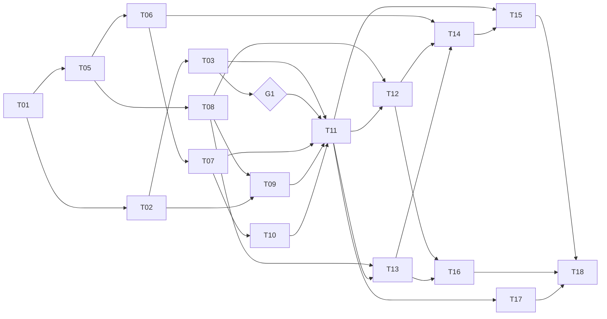

# Task triển khai Da Nang World

Tài liệu gốc: [da-nang-world-analysis-design-plan.md](../da-nang-world-analysis-design-plan.md).
Mỗi file trong thư mục này là một task độc lập, giao cho một AI agent (hoặc người). Task chỉ tóm tắt và cụ thể hóa; khi có mâu thuẫn, tài liệu gốc (mục 21 trước, rồi các mục đặc tả) là nguồn đúng.

## Thứ tự thực hiện

Nguyên tắc sắp xếp: làm trước việc **rủi ro cao và quyết định đi tiếp hay không** (hiệu năng mobile, đồng bộ multiplayer, cảm giác lái xe), song song với phần nền ít rủi ro (database, API, content). Việc tốn công mà phụ thuộc kết quả kiểm chứng (admin, nội dung thật) để sau.

| # | Task | WP | Cỡ | Phụ thuộc | Người làm |
|---|---|---|---|---|---|
| T01 | [Khởi tạo repo](01-wp00-bootstrap.md) | WP-00 | S | - | Agent |
| T02 | [Prototype 3D client + game-core](02-wp01-prototype-3d-client.md) | WP-01 | M | T01 | Agent |
| T03 | [Prototype multiplayer](03-wp02-prototype-multiplayer.md) | WP-02 | M | T02 | Agent |
| T04 | [Cổng kiểm chứng G1](04-wp03-gate-g1.md) | WP-03 | S | T02, T03 | Người + agent |
| T05 | [Gói database](05-wp04-database.md) | WP-04 | M | T01 | Agent |
| T06 | [API nền tảng và xác thực](06-wp05-api-auth.md) | WP-05 | L | T05 | Agent |
| T07 | [Người chơi và nhân vật](07-wp06-player-characters.md) | WP-06 | S | T06 | Agent |
| T08 | [Hệ thống content](08-wp08-content-system.md) | WP-08 | M | T05 | Agent |
| T09 | [Pipeline bản đồ](09-wp09-map-pipeline.md) | WP-09 | L | T02, T08 | Agent |
| T10 | [Web shell và giao diện xác thực](10-wp07-web-shell.md) | WP-07 | L | T06, T07 | Agent |
| T11 | [Tích hợp game](11-wp10-game-integration.md) | WP-10 | L | T03, T04, T07, T09, T10 | Agent |
| T12 | [Phương tiện](12-wp11-vehicles.md) | WP-11 | L | T08, T11 | Agent |
| T13 | [Địa danh và nội dung song ngữ](13-wp12-landmarks.md) | WP-12 | L | T08, T11 | Agent |
| T14 | [Admin và RBAC](14-wp13-admin-rbac.md) | WP-13 | L | T06, T12, T13 | Agent |
| T15 | [Kiểm duyệt](15-wp14-moderation.md) | WP-14 | M | T11, T14 | Agent |
| T16 | [Tối ưu hiệu năng](16-wp15-optimization.md) | WP-15 | M | T12, T13 | Agent + người đo |
| T17 | [Vận hành và bảo mật](17-wp16-ops-security.md) | WP-16 | M | T11 | Agent |
| T18 | [Sẵn sàng beta](18-wp17-beta-readiness.md) | WP-17 | M | T15, T16, T17 | Agent + người |

Cỡ: S nhỏ, M vừa, L lớn (tương đối, không phải thời gian).

## Chạy song song được

Sau T01 có ba luồng độc lập, có thể giao cho nhiều agent cùng lúc:

-   **Luồng A (kiểm chứng rủi ro):** T02, T03, T04.
-   **Luồng B (nền backend và web):** T05, T06, T07, T10.
-   **Luồng C (content và bản đồ):** T08 (sau T05), T09 (sau T02 và T08).

T11 là điểm hội tụ: cần cả ba luồng và cổng G1 đã đạt. Sau T11, T12 và T13 chạy song song; T17 có thể bắt đầu sớm khi T11 xong.



## Quy tắc cổng G1

-   T04 là cổng người quyết định. Nếu **không đạt**, dừng T11 trở đi, áp dụng danh sách giảm tải trong task đó rồi đo lại. Không đầu tư vào admin hay nội dung thật.
-   Agent không cần chờ T04 để làm T05 đến T10, vì các task đó độc lập và rủi ro thấp.

## Prompt mẫu giao cho agent

```text
Đọc tasks/README.md và tasks/<file task>.md, cùng các mục của
da-nang-world-analysis-design-plan.md mà task chỉ định.
Thực hiện đúng phạm vi task, không làm thêm. Làm theo mục 18 của tài liệu
(quy ước, định nghĩa hoàn thành, danh sách điều cấm).
Khi xong: chạy các lệnh ở phần "Kiểm tra" và báo kết quả; ghi giả định mới
vào docs/architecture/assumptions.md; liệt kê file đã tạo/sửa.
Nếu gặp tình huống cần dừng và hỏi (mục 18.1), dừng và hỏi.
```

## Quy tắc chung (tóm tắt mục 18)

-   Mỗi task một nhánh `wp/<id>-<slug>`, PR nhỏ, CI xanh.
-   Đọc tài liệu đúng phiên bản thư viện đã cài; ghi phiên bản vào PR.
-   Mọi dữ liệu từ ngoài qua zod; quyền kiểm tra ở backend; client không quyết định vị trí.
-   Không hard-code nhân vật/xe/địa danh/khu vực; không `import` file từ `content/` vào app.
-   Không đổi schema ngoài DDL (mục 7.10), không đổi giao thức realtime (mục 8) mà không dừng hỏi và tăng `PROTOCOL_VERSION`.
-   Không chạy lệnh phá hủy, không thao tác trực tiếp staging/production.

## Theo dõi tiến độ

- [x] T01 Khởi tạo repo
- [ ] T02 Prototype 3D client + game-core (code xong, test xanh, chạy tốt trên desktop; còn **đo trên điện thoại thật**, xem docs/architecture/benchmarks.md)
- [x] T03 Prototype multiplayer (server, client dự đoán/nội suy, e2e 2 trình duyệt, loadtest đạt trên máy dev; còn đo lại qua mạng thật)
- [ ] T04 Cổng G1 (công cụ `/dev/bench` + mẫu bảng + quy trình đã xong, test và e2e đạt; còn chờ người đo trên điện thoại và ký kết luận)
- [x] T05 Gói database (Drizzle + 3 migration, seed idempotent, role/RLS, admin:create, 20 test; chạy thật trên Supabase qua session pooler)
- [x] T06 API nền tảng + xác thực (39 integration test, OpenAPI, chạy với DB thật; Redis dùng kho trong bộ nhớ khi chưa cấu hình REDIS_URL)
- [x] T07 Người chơi và nhân vật
- [x] T08 Hệ thống content (schema manifest, content-cli: new/validate/build/publish/sync/credits, placeholder CC0; 33 test; sync chạy thật trên DB dev; publish S3 chưa chạy được vì chưa có MinIO/S3)
- [x] T09 Pipeline bản đồ (OSM thật 4809 phần tử → 16 chunk 0.49 MB, test golden, API zone, viewer; người duyệt xác nhận bố cục; publish S3 chưa chạy được)
- [x] T10 Web shell (Next 16 + next-intl vi/en, Tailwind, auth/character/profile/play/legal, i18n:check, 10 unit test + 4 e2e; chưa có xem trước 3D nhân vật)
- [ ] T11 Tích hợp game
- [ ] T12 Phương tiện
- [ ] T13 Địa danh và nội dung song ngữ
- [ ] T14 Admin và RBAC
- [ ] T15 Kiểm duyệt
- [ ] T16 Tối ưu hiệu năng
- [ ] T17 Vận hành và bảo mật
- [ ] T18 Sẵn sàng beta
